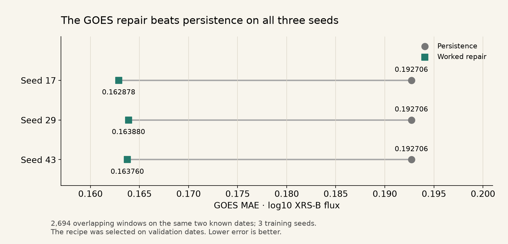
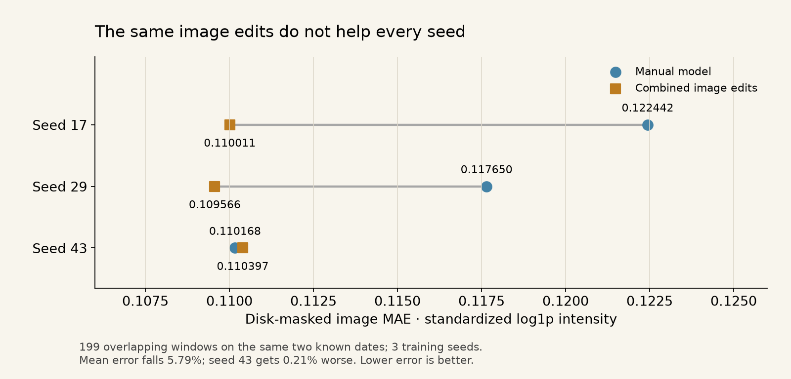

# Solar recipes across three training seeds

We reran the saved image edits and tested a repair for the failed measurement forecast. The GOES repair beat persistence on all three seeds. The image edits helped two seeds and slightly hurt the third. That makes the GOES repair the dependable worked example in this qualification; the image experiment demonstrates why we repeat a result.

These runs use the same real satellite observations and date partitions as the workshop. Seeds 17, 29, and 43, the recipes, selection rule, and acceptance checks were saved [before training](../evidence/solar-fixed-recipes-2026-11-14/protocol.json). The final dates had already been inspected in the earlier rehearsal. This is a **teaching retest**, not another unseen forecasting benchmark.

## Repair the measurement forecast

The original six-run search gave each model 60 update steps. Its inputs were standardized, but its output had to learn the scale of log-flux from a random starting point. The selected model's seed-17 final error was 2.468975; persistence scored 0.192706. A falling training loss had not made it a usable forecast.

The [worked repair](../examples/solar/qualification/goes_scaled.py) starts at persistence and learns a correction. Its last layer starts at zero. Predictions and targets use the same training-fitted scale during optimization, and predictions return to log-flux units for independent scoring. It uses absolute-error loss and a longer, bounded training budget. These changes are tested together; this experiment does not establish which change accounts for the gain.

We tested direct and residual versions of an MLP and a temporal CNN, each at 400 and 1,200 updates. Every configuration used width 16, learning rate 0.001, and batch size 64. We selected one recipe by its mean validation error across all three seeds: the residual MLP with 1,200 updates. Its mean validation MAE was 0.149284, compared with persistence at 0.178267. We froze its source and trained weights before evaluating the known final dates.

| Training seed | Historical 60-step model | Persistence | Selected repair | Repair versus persistence |
|---|---:|---:|---:|---:|
| 17 | 2.468975 | 0.192706 | 0.162878 | 15.48% lower |
| 29 | 2.440724 | 0.192706 | 0.163880 | 14.96% lower |
| 43 | 2.057247 | 0.192706 | 0.163760 | 15.02% lower |
| Mean across seeds | 2.322315 | 0.192706 | 0.163506 | 15.15% lower |

The measure is mean absolute error in log10 XRS-B flux. Each seed evaluates the same 2,694 overlapping forecast windows on February 13–14, 2014. These are three training repetitions on one two-day evaluation period, not three independent datasets. The recipe passes the predeclared requirement to beat persistence on every seed.



The notebook preserves the original search and adds **Train the worked GOES repair** beside it. Inspect or edit the code, run its free check, then train the repair explicitly. Its actual source, weights, validation result, and trace are saved in your project. Final selection considers that run using validation error, just like the other models. Opening this section does not train anything or replace a saved run.

## Repeat the image edits

We replayed the exact saved sources from the earlier agent exercise. Each run used a residual image predictor, width 8, learning rate 0.001, batch size 8, and 40 updates. The three stages were the manual model, the absolute-error loss change, and that loss with a zero-initialized residual output layer. Each trained from scratch; final evaluation reused its saved weights.

| Training seed | Manual model | Absolute-error loss | Loss + zero-initialized output | Combined edits versus manual |
|---|---:|---:|---:|---:|
| 17 | 0.122442 | 0.120769 | 0.110011 | 10.15% lower |
| 29 | 0.117650 | 0.118010 | 0.109566 | 6.87% lower |
| 43 | 0.110168 | 0.108801 | 0.110397 | 0.21% higher |
| Mean across seeds | 0.116753 | 0.115860 | 0.109991 | 5.79% lower |

Persistence scored 0.125762 for the same 199 image windows. The metric averages absolute error inside each target solar-disk mask, then averages windows equally. Its units are training-standardized log1p intensity. Keep these scores separate from GOES log-flux errors.

Seed 43's manual model already scored close to the combined edits. The absolute-error change alone did better on that seed; adding the zero-initialized layer made its result worse. Both initialization and sampled training batches change with the seed. These runs do not isolate which randomness caused the difference.

The combined edit lowers the average error, but **fails the predeclared requirement to improve every seed**. We retain that failure. The earlier 10.15% result remains a correct description of seed 17; it is not a promise about every run or every future agent proposal. No new research-agent calls were made here, so this is not a replication of the agent's ability to discover the edits.



## Reproduce and inspect

All 36 planned training runs and all 15 frozen evaluations completed. Their recorded local execution times total 84.95 seconds for training and 13.97 seconds for final inference on the qualification machine. This excludes initial data loading, installation, publication, and human review. There were no provider calls or newly billed compute jobs.

The [summary](../evidence/solar-fixed-recipes-2026-11-14/summary.json) contains every final result. [Validation records](../evidence/solar-fixed-recipes-2026-11-14/validation.json) include every configuration, loss history, and per-window error. [Final records](../evidence/solar-fixed-recipes-2026-11-14/evaluation.json) include matching timestamps and errors. The [evaluation freeze](../evidence/solar-fixed-recipes-2026-11-14/evaluation-freeze.json) records the selected recipe and source/weight checksums. Historical rehearsal files remain unchanged.

From the repository, use the prepared `data/solar-v1` dataset and its verified manifest:

```sh
uv sync --frozen --extra solar
uv run python scripts/qualify_solar.py validate
uv run python scripts/qualify_solar.py evaluate
uv run python scripts/qualify_solar.py summarize
```

The committed protocol supplies the frozen sources, seeds, and selection rule. For a new protocol, first choose a new evidence directory and identity, then run `freeze` before training. Training artifacts stay under `.workshop/solar-fixed-recipes-2026-11-14`: source, requests, weights, loss histories, predictions, stdout, and stderr. A restart reuses matching completed executions. Changed requests or uncertain interrupted executions stop for inspection rather than silently running again.

The data cover a short interval and adjacent windows share observations. The gain establishes a repeatable teaching example on these dates. It does not establish operational forecasting accuracy, superiority over a tuned solar model, or a general benefit from agent-directed research.
