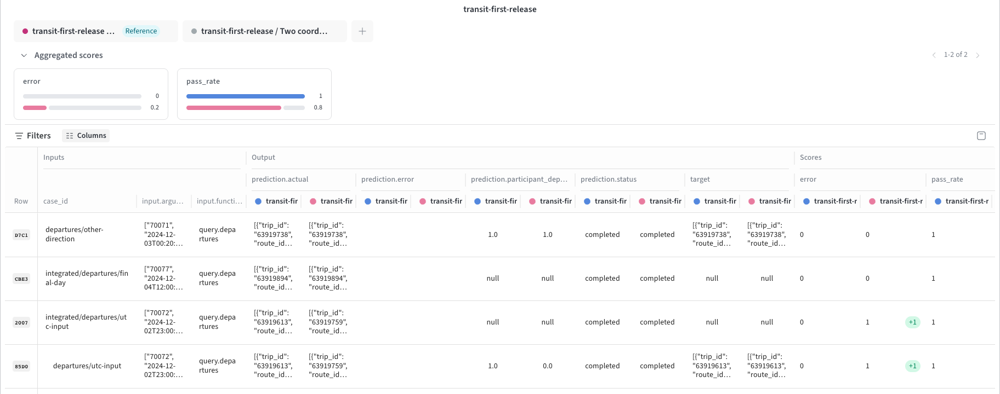

# Build a transit app with a team of coding agents

**Technical preview.** The local checks, live worker executions and native Forge readback have been exercised. External-account access and a participant rehearsal are still required before advertising a ready-to-run class.

This six-hour workshop gives each participant a small product to deliver: a departures board using real MBTA schedule records. They write the coordination code around coding agents, inspect the resulting work in Agent Lens, and test the combined application. Then they use an incident from that build to create a checked project lesson and run a matched follow-up with and without it.

The product team and deadline are fictional. The transit records are real. The app uses a historical timetable; it does not show current service, vehicle positions or predicted arrivals.

The session includes ten-minute breaks at 1:35 and 4:45, plus a twenty-minute break at 3:00. The [facilitator guide](transit-facilitator.md) has the complete schedule and exact notebook controls. The deck follows one departure through its records, then one code change through a worker, integration and release.

## What participants build

Version one lists the scheduled departures for a selected stop, service date and time. It needs to join stops, trips, stop times and active service dates. A departure after midnight still belongs to its original service day. Calendar exceptions must override the ordinary weekly pattern.

The follow-up finds the last direct train between two retained stops. It must preserve arrival after midnight and report when the available schedule has no direct service. The rider can download the selected itinerary. The two follow-up builds receive identical starting code, requirements, model settings and limits. Each uses two workers. One can retrieve the reviewed project lessons; the other cannot.

The workshop separates the delivered product from the process that built it. Acceptance scenarios score the departure lists and journeys. Separate measures describe elapsed time, cost, blocked tasks, repeated task claims, retries and integration failures. Repeated claims include recovery attempts; we do not measure duplicated reasoning or overlapping code. One paired follow-up is a teaching comparison, not evidence that shared memory improves software engineering in general.

## Data and setup

The source is the [MBTA GTFS archive dated November 28, 2024](https://cdn.mbtace.com/archive/20241128.zip), with feed validity November 28 through December 4. The archive SHA256 is `a034da05b7d71d9ce8977b9c59bee831cec52c4bf4a560ae3ad09e3064c27bcd`. The prepared subset includes 10 platforms across Kendall/MIT, Charles/MGH, Park Street, Downtown Crossing and South Station, retaining 1,252 trips and 6,260 stop-time rows. The source manifest and preparation code are authoritative for the selected records and checksums.

One retained record is trip `63926435` at stop `70076`, toward Alewife. Its departure time is `24:08:00` under `ThanksgivingDay` service. For service date November 28, that means November 29 at 00:08 Eastern. This is why a function that accepts only clock hours 0 through 23 is insufficient. [GTFS defines service-day times and the schedule fields](https://gtfs.org/documentation/schedule/reference/); [MBTA documents its implementation](https://github.com/mbta/gtfs-documentation/blob/master/reference/gtfs.md).

Participants copy the current template into their own writable Forge project. The notebook uses their existing authentication and an adjustable inference allowance, defaulting to $8. Notebook compute charges are separate. There is no workshop gateway, shared access token or required remote Sandbox entitlement. A local checkout uses the same authored notebook through `uv sync --frozen` and `uv run marimo edit`.

Opening, editing, selecting a view or restoring saved work does not launch workers. Explicit run controls start paid execution. Durable receipts preserve completed requests and their outputs; publication can be retried without repeating them.

Each build allows up to 16 logical model calls and eight actions per task, with a 32K maximum output allowance per request. The same limits apply to the single-worker and two-worker builds and to both follow-up versions. Provider attempts and their costs remain recorded separately.

### When a builder stops

Open its saved task and error before retrying. The serialized input and a 4,096-byte request-overhead allowance must fit within 32,768 bytes; the output limit is 32,768 tokens. These are different units. A large code edit can exceed the input limit even after the earlier copies of that file have been removed from the next request. An output-limit error means the model used its response allowance before returning a complete action.

Files, completed responses and test results remain saved. Exporting them again does not rerun the builder. Before the comparison is frozen, an explicit recovery can retry a stopped task with the same coordinator and settings, but it does not increase these limits or guarantee success. An interrupted build cannot resume with different coordinator code while keeping results from its earlier code. Use a fresh workspace for a changed experiment.

If the new feature remains incomplete, inspect the failed checks and retain a version that passed the release checks. The prepared reference is a separate, instructor-authored continuation for practicing the remaining steps. It never replaces a live result. A context or output failure in one memory condition does not establish that memory caused it.

## Code participants change

| Step | Participant code | Visible consequence |
| --- | --- | --- |
| Acceptance | `check_departures()` | The real after-midnight train passes; a missing train or wrong service day fails. |
| One worker | `build_worker_request()` and `dispatch_action()` | Its actual request contains the task and context; the selected allowed tool runs and returns an observation. |
| Task coordination | `ready_tasks()` and `claim_task()` | Dependencies gate execution, and a task receives one owner. |
| Shared memory | `select_memories()` | The follow-up worker receives relevant approved lessons, with supporting records. |
| Development scoring | `score_scenario()` | A wrong or misordered departure list fails the local check. |
| Release | `release_decision()` | Missing or failed required checks block release. |

The notebook exposes the request, tool dispatch, task selection, claim and memory functions you edit; the full coordinator is in [factory.py](../src/forge_workshop_kit/factory.py). Model calls, file reads, edits, tests, task claims and memory reads carry worker, task and build identities. Independent working copies prevent workers from overwriting unfinished changes. People review the task contracts and patches before the integration step tests the combined code.

Memory is a scoped project record. It contains a rule, its source event, the contract version it concerns and a review state. Retrieval checks the lesson's applicability `version`; `source_revision` records where its evidence came from and may differ. A proposed interpretation is not a verified fact. A later contract can invalidate an earlier lesson. The exercise checks which lesson reached the worker request and what subsequently executed; a read event alone does not establish benefit.

## Forge investigation

- **Agent Lens:** follow one task claim through a worker conversation, file edit, test result and handoff. For the follow-up, inspect the memory read and next request.
- **W&B runs:** compare the fixed request settings, elapsed execution, model usage and costs for each build.
- **Artifacts:** preserve the dataset reference, approved contracts, changed files, exact integrated code, task records, lessons and release decision.
- **Weave and native Evaluation Tables Preview:** align the same scenario inputs across frozen builds, inspect actual outputs and keep unavailable results explicit. Use the working Weave-backed publication path.
- **Reports:** explain the delivered feature, what changed and whether the checks support the release.

The separate CES v2 evaluation endpoint is not required for this workshop. Its historical HTTP 500 is not evidence that the working Evaluation Tables Preview path is unavailable. A publication failure leaves the notebook comparison and saved executions intact; use the publication-only retry.

## What the comparison can show

You can run the saved timetable and write the after-midnight acceptance check before connecting. After the single-worker build, review and integrate its patches, then preview its actual app. Repeat that review and integration for the two-worker build. The follow-up starting release is selected only after both integrations exist, using the existing team-then-solo preference for a passing build.

Keep the initial single-worker and coordinated build records. They explain differences in work allocation, integration and cost. The memory comparison uses matching follow-up requests and initial code, with shared lessons as the only intended treatment difference. It still contains only one pair per participant.

Freeze the versions before final acceptance scenarios run. Final checks stay outside coding-worker requests and memory construction. Failed builds remain represented. An unavailable execution or judgment is different from a completed application that returns the wrong departure.

A release is a versioned workshop artifact, not automatic production deployment. The last exercise reloads one saved case and reproduces its output. A blocked release with a clear failed check is a valid workshop outcome.

## Sources and preparation status

The design draws on [StrongDM’s software factory](https://factory.strongdm.ai/), [Anthropic’s compiler experiment](https://www.anthropic.com/research/building-c-compiler), [Claude Code’s task and messaging model](https://code.claude.com/docs/en/agent-teams), [Gas Town](https://github.com/gastownhall/gastown), and [Beads](https://github.com/gastownhall/beads). These are references for coordination patterns, not required installations or evidence that this workshop’s agent team will outperform its baseline.

[Google’s agent-scaling study](https://research.google/blog/towards-a-science-of-scaling-agent-systems-when-and-why-agent-systems-work/) supports measuring task structure and coordination costs. [Anthropic’s memory account](https://www.anthropic.com/research/components-of-agent-memory) provides examples of verified rules, unchecked guesses and corrections against original records.

The deck contains explanatory diagrams, actual source-data examples and a capture of the reference app. A native Agent Lens capture shows the R3 presentation worker's passing component test; its sibling query worker exhausted its output allowance. The final result table uses the separate R5 rehearsal; the earlier R4 native captures retain their own labels.

### What the final engineering rehearsal showed

R5 produced the following final scenario results. Open the native [first-release comparison](https://forge.coreweave.com/wandb/wandb/forge-workshop-kit?nw=dg2ogm6wp3z) and [follow-up memory comparison](https://forge.coreweave.com/wandb/wandb/forge-workshop-kit?nw=f9jpm0yjsxy). Both initial builds had passed all five public development checks, which did not guarantee a correct combined product.

| Build | Final scenarios passed | Builder elapsed | Observed model cost |
| --- | ---: | ---: | ---: |
| One worker | 10/10 | 124.78 s | $0.01107 |
| Two workers | 8/10 | 94.91 s | $0.01221 |
| Follow-up without memory | 12/18 | 212.88 s | $0.02565 |
| Follow-up with memory | 12/18 | 96.13 s | $0.01600 |

The capture comes from the actual public R5 comparison. Its UTC-input rows show trip `63919613` in the reference output and `63919759` in the team output. The passing and failing values belong to the same scenario inputs.

The two team failures were the query and rendered-board checks for the same UTC-input bug. A request at 23:00 UTC means 18:00 Eastern and should return trip `63919613` at 18:03. The team query anchored the service day to the caller’s timezone and selected the later service-clock trip `63919759`. This changed which train was selected; it was not merely a display-format error. The solo query preserved the feed timezone.

Elapsed time excludes human review and integration. Both follow-up query workers stopped before testing: one reached the input bound after writing its file; the other exhausted its output allowance. Their presentation files were retained. Neither result supports releasing the follow-up or claiming a memory benefit. The lesson proposal added $0.00143474; total observed inference cost was $0.06635800 across 31 requests, with no unknown usage. All 56 final scenario rows remain represented. The supported release is the single-worker departures board; the last-direct-train feature remains blocked. The separate 18/18 reference app is instructor-authored and is not substituted for these agent results.

The [captioned worked example](../decks/transit/public/walkthrough/index.html) shows code edits and free checks in the actual notebook, followed by the reference app. It runs no agents. Use it to preview the exercises, not as evidence that a participant's unexecuted edit produced a result. The [recording receipt](../decks/transit/public/walkthrough/recording-receipt.json) records that boundary.

The [recorded R4 build walkthrough](../decks/transit/public/walkthrough/index.html#recorded-result) follows saved agent work from the task board through its actual patch, exact Agent Lens test span, native comparison and exported application. Both first-release builds passed 10/10. Both follow-ups scored 14/18 after query workers reached an input bound before testing. This replay preserves the failures and does not establish a memory benefit. It launches no new workers.

The separate [reference-app download](../decks/transit/public/walkthrough/transit-reference-app.zip) contains the instructor-authored implementation, historical data and its 18 passing reference scenarios. Extract it and run `uv run --with marimo marimo edit app.py`. This path needs no inference account and makes no model calls.

Live worker runs and native comparison readback are recorded. Fresh external-account copying and a human rehearsal remain required before describing the workshop as ready for attendees.
