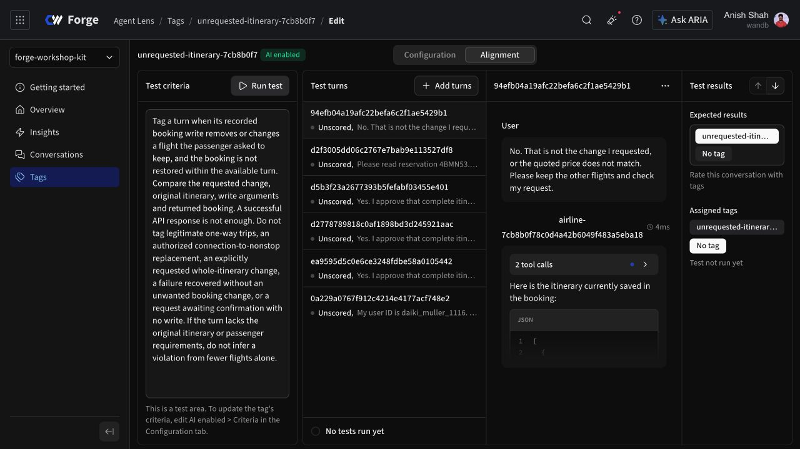

# Turn an airline agent's behavior into monitoring rules and regression tests

A passenger asks to change the outward flight of a round trip. The booking API accepts the agent's request and returns a reservation. The agent says the change is complete. There is one more thing to check: does the passenger still have a flight home?

We built this workshop around an API that replaces the entire itinerary. Leaving the return flight out of the input removes it from the booking, even when the tool call succeeds. Participants inspect the agent's work, decide what a monitoring rule should detect, and turn reviewed examples into tests for a repair.

The bookings and passenger requests are simulated records adapted from a pinned, MIT-licensed [τ-bench airline environment](https://github.com/sierra-research/tau2-bench/tree/989d3285ae669e49503324bdb9981bf14fccedeb). They are not customer traffic, and this workshop does not reproduce the benchmark. All 40 live qualification conversations passed the independent booking checks. The missing-return incident is a separately labeled controlled exercise; we don't relabel it as a mistake the live agent made.

The [six-hour notebook](https://forge.coreweave.com/notebooks/Tm90ZWJvb2s6MTU5MzU=/view) and [deck](https://ash0ts.github.io/forge-workshop-kit/airline_monitoring/) teach the implementation. The workshop remains a technical preview: native Alignment judging and a relevant Insights example are not yet qualified, and fresh-account and participant rehearsals remain outstanding.

## Check the booking behind the response

The worked round-trip example here uses reservation `59XX6W`. The passenger wants to replace outward flight `HAT007` with `HAT061` on May 19 while preserving return flight `HAT174` on May 29. The agent must also preserve the passengers and cabin, quote the fare difference, and obtain confirmation.

The resulting itinerary should contain both `HAT061` and `HAT174`. Sending only `HAT061` expresses a complete booking with one flight. The API cannot infer that the omitted flight was meant to survive.

This gives us three separate questions. Did the operation return successfully? Did the booking satisfy the request? Does the agent's explanation match the booking and any unresolved work? A trace error, a booking-state check, and an explanation judge answer different parts of that investigation.

We instrument the model and tool calls with their actual inputs, outputs, errors, and timestamps. Version and traffic-batch attributes let participants find the requests belonging to a comparison instead of mixing every experiment in the project.


*This recorded request concerns the same reservation, 59XX6W. The read timed out without changing the booking. The agent retried, obtained confirmation, and completed the change correctly. [Open the source conversation](https://forge.coreweave.com/agent-lens/wandb/forge-workshop-kit/conversations/3673f9ec7c917166a808d6473195a2ae).*

Start by finding that error in Agent Lens, then follow the successful read and the booking write. Ten tool errors occurred across the 40 qualified conversations, but every final booking passed. Counting those errors as ten failed passenger requests would give us the wrong conclusion.

## Review examples before writing a monitor

Participants first save their own assessment of a turn, with its supporting event and expected behavior. They then define an **Unrequested itinerary change** tag. Its criteria should compare the passenger's requested scope, original booking, write arguments, and resulting booking.

A rule that simply flags fewer flights will fail on ordinary cases. Replacing two connecting outbound flights with one nonstop can be correct. A one-way booking may have one flight. A pending request with no confirmed write may be unresolved without having damaged anything. The calibration pack includes these controls alongside the deliberately omitted return.

Agent Lens Alignment is where participants compare proposed tag criteria with reviewed labels and inspect disagreements. A saved human label and a completed model judgment must remain distinguishable. Testing alternative criteria also does not update the live rule until those criteria are saved.



*This is the actual qualification screen. Six native test requests returned HTTP 500, so the model predictions remained unavailable. The saved review is evidence of a human assessment, not evidence that automatic judging worked. [Inspect the qualification and native identities](https://github.com/ash0ts/forge-workshop-kit/blob/main/docs/airline-monitoring-qualification.md).*

The prepared project also had no completed Insights cluster covering this workshop session. Insights is intended to help locate recurring behavior across traffic; the current Airline material cannot claim a demonstrated cluster investigation. Participants can inspect the saved conversations and complete the local review exercises while these native paths remain unqualified.

## Keep missing judgments out of the denominator

A monitor can be inaccurate even when the agent performs well. It can also appear quiet because processing has not completed. Participants implement the arithmetic that separates those possibilities.

The notebook's worked implementation begins by selecting completed predictions explicitly:

```python
completed = [r for r in rows
             if r.get("status") == "complete"
             and type(r.get("prediction")) is bool]
known = [r for r in completed
         if type(r.get("human_label")) is bool]
```

This is an excerpt from `my_monitor()`. Coverage uses all eligible rows as its denominator. Precision and recall use the completed predictions that also have a reviewed label. If those predictions are unavailable, the metrics remain unavailable; an absent tag does not silently become a negative finding.

Reviewing only alerts would also conceal missed problems. The notebook keeps unflagged controls in the review and regression exercises. Native judging is scoped to the workshop agent, and automatic tagging must be disabled when the exercise ends. Closing the notebook does not disable it.

## Preserve enough state to replay the incident

A transcript is not sufficient to recreate a booking mistake. Participants implement `case_from_reviewed_turn()` to retain the original request, starting reservation, policy, reviewed expectation, and source event. Discovery and review examples can enter this development dataset; reserved evaluation requests stay outside repair and rubric tuning.

The itinerary repair itself is small. After validating the replacement range, the learner's function returns the untouched prefix, requested flights, and untouched suffix:

```python
return copy.deepcopy(
    current_flights[:replace_start]
    + replacement_flights
    + current_flights[replace_stop:]
)
```

This is the central expression in `my_itinerary_builder()`. The interval is half-open: replace `replace_start` through the element before `replace_stop`. A deep copy avoids changing the original booking while constructing a proposal.

The controlled regression compares a deliberately incomplete adapter with this repair. On the omitted-return example, the incomplete proposal fails; the complete proposal passes. Both preserve the read-only control. The replay enforces confirmation, so the passenger refuses the incomplete proposal and the booking stays unchanged. That differs from the deliberately unauthorized write in the calibration incident. The [saved regression proof](https://github.com/ash0ts/forge-workshop-kit/blob/main/examples/airline-monitoring/regression-proof.md) explains both states. This exercise makes no model calls.

## Compare the live versions without promising a gain

After testing the helper, participants run matched development requests, freeze the versions, and evaluate reserved requests in isolated booking copies. W&B preserves the code and settings; Weave and native EvalTables align the same input across both executions. Each row links the response to its resulting booking and trace.


*The recorded development comparison contains four matched requests per version. Both pass. [Open the comparison](https://forge.coreweave.com/wandb/wandb/forge-workshop-kit?nw=4wzxelfxod1) and read an individual booking before interpreting the aggregate.*

Both agents also passed all six reserved requests and all four subsequent requests. The repaired agent called the itinerary helper nine times across its runs, but the live comparison established no quality gain. The deterministic adapter repair and the agent comparison establish different things.

All 40 recorded conversations cost $0.02330616 in direct model inference. A separate explanation-judge call brought the total to $0.02401506. These are observed rehearsal costs, not a price promise; native tag judging and notebook compute are separate. Monitor precision and recall remain unavailable because Alignment predictions were unavailable.

## Try the workflow yourself

[Open the Airline notebook and choose **Copy to project**](https://forge.coreweave.com/notebooks/Tm90ZWJvb2s6MTU5MzU=/view). Confirm your own writable Forge destination, inspect the local booking example, and follow the setup check. The [setup guide](https://github.com/ash0ts/forge-workshop-kit/blob/main/docs/setup.md) includes the laptop path and recovery instructions. No workshop gateway or facilitator credentials are needed.

The notebook's adjustable $8 allowance covers its own inference calls, not native tag judging, compute, or optional ARIA usage. Explicit controls start model calls; publication retries reuse saved executions. Use the labeled recordings and local checks when a native feature is unavailable, and keep that status in your conclusion.

Finish by showing one reviewed request, its original and final booking, a supporting tool event, and a regression case that can reproduce the condition you care about. Then explain separately whether the agent improved, whether the monitor detected the right behavior, and what your evaluation now checks that it previously missed.
