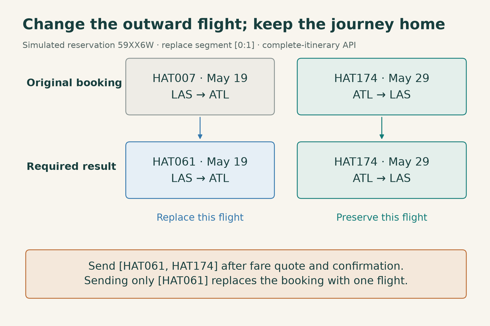
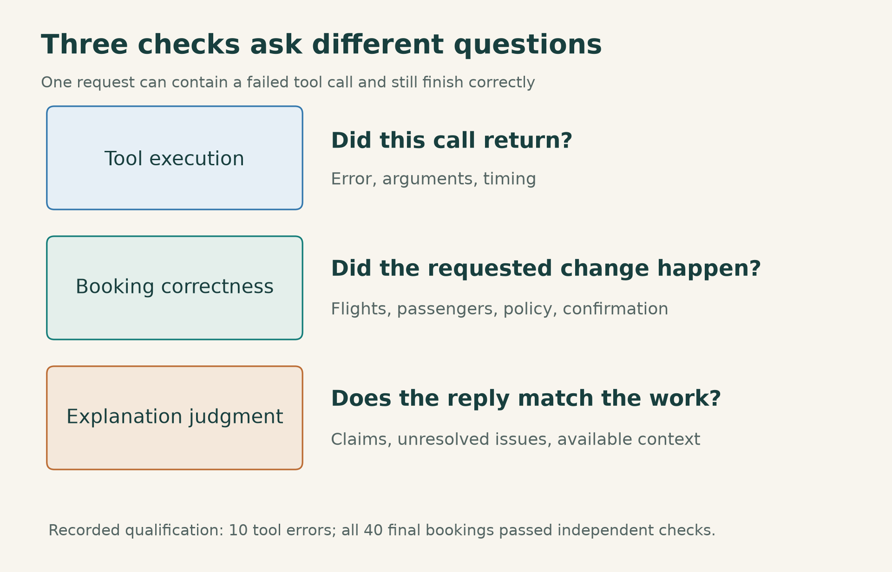
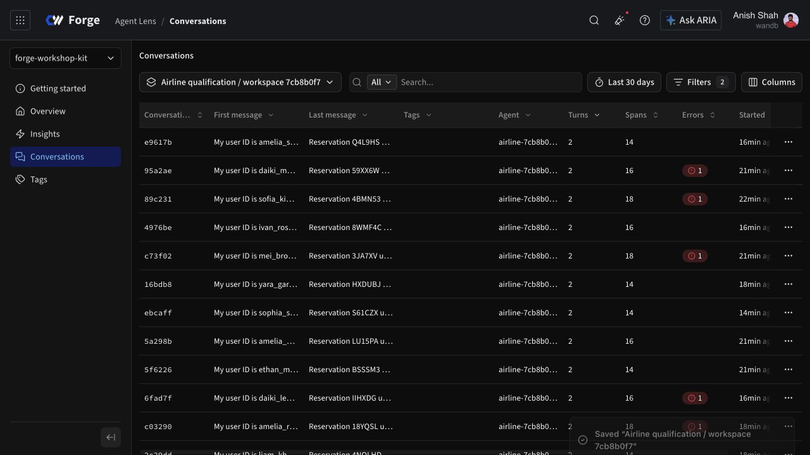
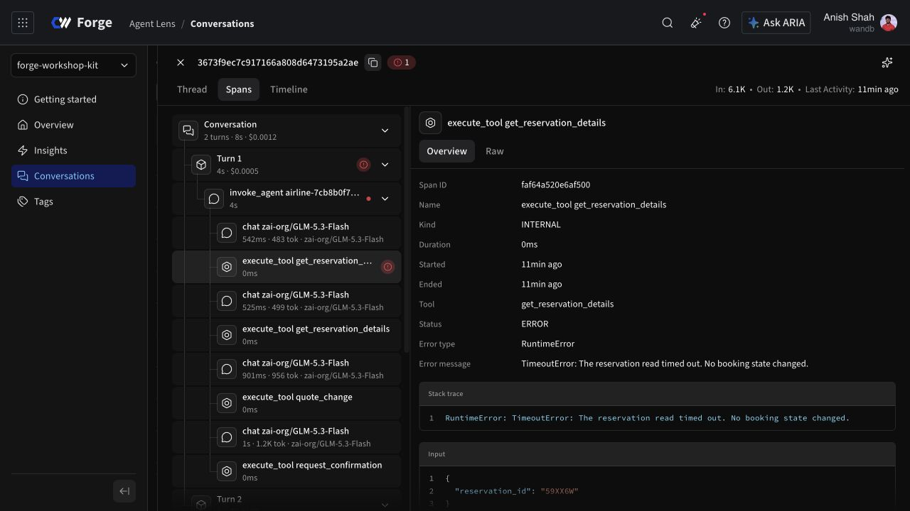
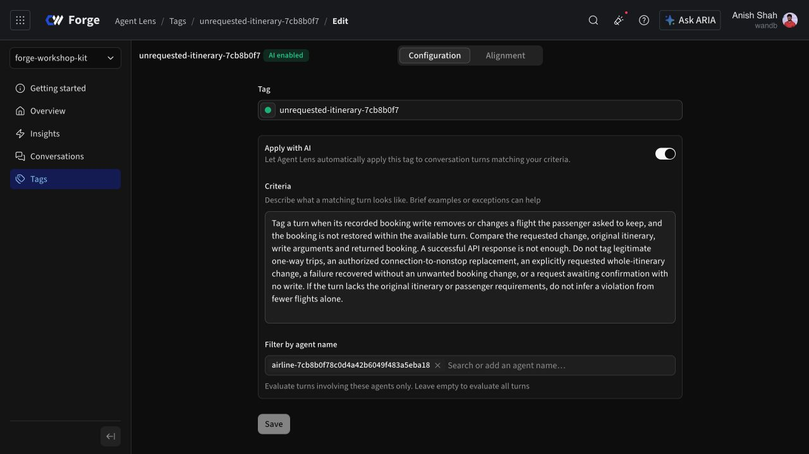
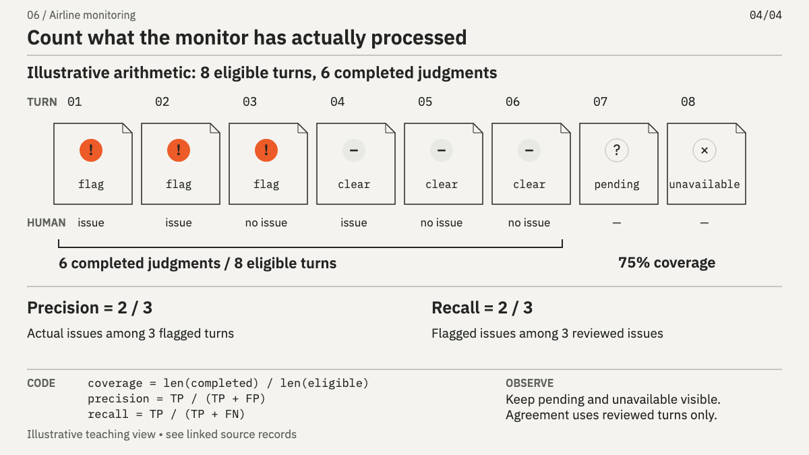
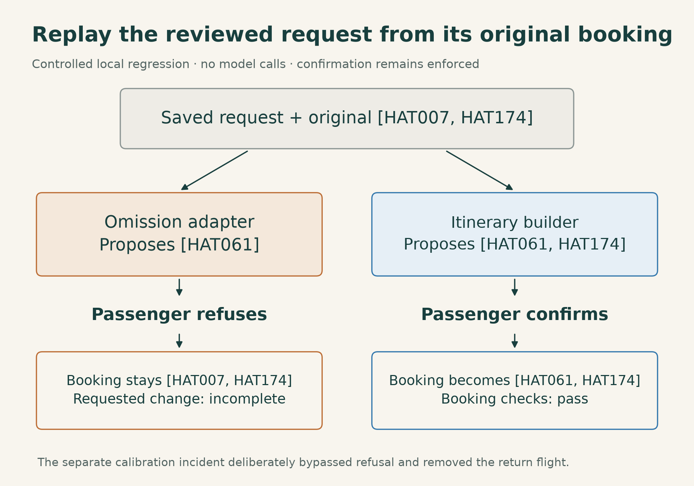
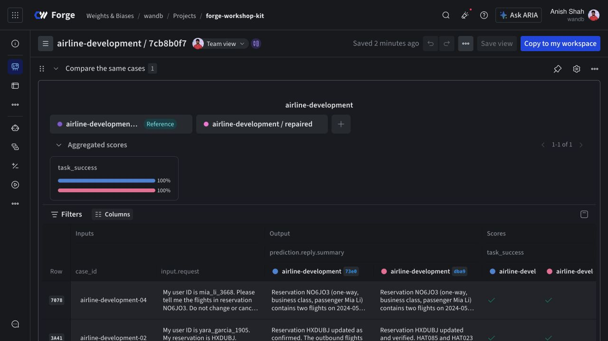

# Turn an airline agent's behavior into monitoring rules and regression tests

A passenger wants to change the outward flight of a round trip. The agent has to find a replacement, explain the fare difference, and get confirmation. It also has to leave the return flight alone. That last requirement is easy to lose when the booking API replaces the entire itinerary.

We built this workshop to follow that request from the conversation to the booking, then into a monitoring rule and a regression test. The question is practical: when an agent says it changed a flight, what would let us check its work across many requests, find the exceptions, and test a repair before releasing it?

Start by opening a conversation in Agent Lens and comparing the passenger's request with the returned itinerary. Once we have reviewed a few turns, we can write a tag that looks for unrequested changes and test whether it agrees with those reviews. We then save an incident's original booking and requested change as a regression case. Comparing both agent versions on that case in EvalTables shows whether the repair preserves the journey home.

The bookings are simulated records adapted from a pinned, MIT-licensed [τ-bench airline environment](https://github.com/sierra-research/tau2-bench/tree/989d3285ae669e49503324bdb9981bf14fccedeb). We use its data and complete-itinerary update behavior; this is a workshop adaptation, not customer traffic or a benchmark replication. The live qualification completed all 40 conversations with passing booking checks. A separate controlled omission exercise provides a failure we can reproduce without pretending the agent made it spontaneously.

You can follow the records here without an account, then open the [six-hour notebook](https://ash0ts.github.io/forge-workshop-kit/packet/start/airline_monitoring.html) and connect your project. The [deck](https://ash0ts.github.io/forge-workshop-kit/airline_monitoring/) supplies the code walkthrough. Native Alignment judging, a relevant Insights example, fresh-account access, and a participant rehearsal remain unqualified; the current workshop is a technical preview.

## Keep the return flight in the write

Our worked round trip is reservation `59XX6W`. The passenger asks to replace `HAT007` from Las Vegas to Atlanta on May 19 with `HAT061`. The return, `HAT174` on May 29, should survive unchanged. So should the passengers and cabin. The agent must quote the price difference and ask before writing.



*The API takes the complete replacement itinerary. Sending `[HAT061]` supplies a one-flight booking; `[HAT061, HAT174]` preserves the journey home. These identifiers come from the [saved development request](https://github.com/ash0ts/forge-workshop-kit/blob/main/decks/airline_monitoring/data/representative-case.json).*

The [itinerary guide](https://ash0ts.github.io/forge-workshop-kit/guides/airline_monitoring/itinerary/index.html) reveals the requested edit, submitted list, and resulting booking separately. Compare the unchanged return flight in each state before deciding whether the write is correct.

A successful API response establishes that the operation returned. It does not establish that the supplied list matched the passenger's request. We therefore keep three kinds of checking visible: tool execution, independent booking-state checks, and a judge of the agent's explanation.



*One conversation can contain a failed read, recover, and produce the correct booking. Conversely, a successful write can save the wrong itinerary. Each check needs the evidence for its own question.*

The notebook begins with a local booking example. Inspect its flights and predict what should remain before connecting to a service. Later you write the instrumented conversation, the monitor's arithmetic, the regression-case constructor, and the itinerary helper. These functions affect the executions you compare.

## Find the request, then follow the recovery

We attach the agent version and traffic-batch identity to the recorded work. Without those fields, a conversation list can mix the starting agent, a candidate repair, and requests from another exercise. A saved view makes the scope inspectable.



*The instructor's saved view filters the workshop agent and its `airline.version` attribute. Find the row mentioning `59XX6W`, then open its conversation. The error badge counts tool errors, not incorrect bookings. [Open the saved view](https://forge.coreweave.com/agent-lens/wandb/forge-workshop-kit/conversations/views/01a1dc0a-3ea9-73bd-b0b8-bd7ecd7d9951).*

In that recorded conversation, `get_reservation_details` timed out before returning the booking. The trace records the actual exception, arguments, and timing. The model received the failure, retried the read, obtained confirmation, and completed the requested change correctly.



*Read the selected span's reservation ID and error message. Open the conversation and follow the later read, quote, confirmation, and write; the write is below the screenshot's visible area. The read timeout made no booking change. [Open this exact tool span](https://forge.coreweave.com/agent-lens/wandb/forge-workshop-kit/conversations/3673f9ec7c917166a808d6473195a2ae/spans/turns/b4ad558d6ba484805a84991dd3f9e7c1/spans/faf64a520e6af500).*

Ten tool errors occurred across the 40 live qualification conversations, while all final bookings passed the independent checks. If we labeled every conversation containing a red span as an agent failure, we'd build a monitor of recoverable tool errors and call it booking quality.

## Decide what the tag should detect

We ask participants to review a turn before writing the tag criteria. Save the passenger's requested scope, the event that supports your judgment, and what should have happened. Then turn that assessment into an **Unrequested itinerary change** rule.

“Fewer flights” is an insufficient rule. A passenger may explicitly replace two connecting flights with one nonstop. A one-way itinerary may have only one flight. A request still awaiting confirmation may have made no write at all. The rule needs the original booking, requested change, write arguments, and returned state, along with any recovery visible in the turn.



*Inspect three fields: the criteria describe the behavior; **Apply with AI** controls automatic judging; **Filter by agent name** limits its scope. This is a recorded instructor configuration. Automatic judging was disabled at the end of qualification. [Open the native configuration](https://forge.coreweave.com/agent-lens/wandb/forge-workshop-kit/tags/01a1dbfc-34e0-7540-a690-0fb598377ae6/edit).*

Alignment compares alternative criteria with reviewed labels. We inspect disagreements before choosing the live rule. A proposed criterion doesn't become the deployed criterion until it is saved, and a human label doesn't become a model prediction merely because both appear in the same view.


*The expected label was saved, but six native test requests returned HTTP 500. The model judgment remained unavailable. This screenshot documents that limit rather than implying a successful calibration. [Open the recorded native identities and qualification](https://github.com/ash0ts/forge-workshop-kit/blob/main/docs/airline-monitoring-qualification.md).*

The prepared project also had no completed Insights cluster covering this workshop session. A cluster could help us find related requests, but we haven't demonstrated that investigation for Airline yet. Saved conversations and the local calibration pack remain available for reviewing individual examples. Neither a cluster nor a saved filter automatically supplies the starting state and expected behavior needed for a regression test.

## Count what was processed before calculating accuracy

An empty tag column can mean that the rule found no issue. It can also mean that the turn hasn't been judged. We make processing status part of the learner's monitor implementation so those cases don't collapse into the same result.

The worked `my_monitor()` selects completed boolean predictions, then finds which of them also have a human label:

```python

# A missing result is not a negative finding.
completed = [r for r in rows
             if r.get("status") == "complete"
             and type(r.get("prediction")) is bool]

# Agreement requires an explicit human label as well.
known = [r for r in completed
         if type(r.get("human_label")) is bool]
```

Coverage uses all eligible turns as its denominator. Precision asks how many flagged issues were supported by the reviewed labels. Recall asks how many reviewed issues were found. We keep unflagged controls in the review because inspecting only alerts would hide the missed issues.



*These are metric definitions, not measured native-monitor results. Precision and recall remain unavailable for the recorded Airline qualification because the native test predictions were unavailable. An empty denominator stays missing.*

Native judges also work with turn-level context. If the original itinerary or passenger instruction is absent from the selected turn, record insufficient evidence instead of inferring a violation from the final list of flights. That limitation belongs in the review, not in a hidden assumption inside the rubric.

## Make the reviewed incident reproducible

To test a repair, we need to reconstruct the condition that exposed the problem. A transcript alone won't do it. `case_from_reviewed_turn()` preserves the original request, starting booking, policy, expected behavior, and source event. Discovery examples and reviewed controls can enter this development dataset. Reserved evaluation requests stay outside repair and rubric tuning.

For this API, the helper must construct a whole itinerary. The main expression in `my_itinerary_builder()` is small:

```python
return copy.deepcopy(
    current_flights[:replace_start]  # Keep flights before the change.
    + replacement_flights           # Replace only the approved interval.
    + current_flights[replace_stop:] # Keep the return or later connections.
)
```

The range is half-open: replace the element at `replace_start` through the element before `replace_stop`. For `59XX6W`, `[0:1]` selects the outbound flight. The untouched suffix contains `HAT174`, which must be copied into the proposed booking. The full function also validates its inputs; the deep copy keeps proposal construction from mutating the original booking.

We compare that helper with a deliberately incomplete adapter on the same reviewed cases. Confirmation remains enforced in the replay, which makes its outcome different from the calibration incident that deliberately bypassed refusal.



*The faulty replay leaves the requested change incomplete. It does not remove the return, because the simulated passenger refuses the incomplete proposal. The separate calibration incident deliberately ignored that refusal. Both adapters preserve the read-only control. [Inspect the saved regression proof](https://github.com/ash0ts/forge-workshop-kit/blob/main/examples/airline-monitoring/regression-proof.md).*

This comparison makes no model calls. It demonstrates the effect of repairing the itinerary-construction code under fixed inputs. We still need a separate agent comparison to learn whether supplying that helper changes the agent's completed work.

## Compare the booking outcomes after the repair

We run matched development requests, freeze the versions, and evaluate reserved requests in isolated booking copies. W&B saves the code and settings; Weave and native EvalTables align the same request across both executions. The output includes the resulting booking as well as the reply.



*Keep the starting version selected as Reference. Open an individual request and compare the returned flight lists and checks. The two 100% bars are a tie across four development requests per version. [Open the actual comparison](https://forge.coreweave.com/wandb/wandb/forge-workshop-kit?nw=4wzxelfxod1).*

Both agents also passed all six reserved requests and all four subsequent requests. The repaired agent called the itinerary helper nine times across its runs, so the added code did enter execution. The live comparison nevertheless established no booking-quality gain. The earlier helper repair and this tie answer different questions.

All 40 recorded conversations cost $0.02330616 in direct model inference. A separate explanation-judge call brought the total to $0.02401506. Native tag judging and notebook compute are separate charges; these rehearsal numbers aren't an attendee price guarantee. The [qualification record](https://github.com/ash0ts/forge-workshop-kit/blob/main/docs/airline-monitoring-qualification.md) retains the executions, costs, and unavailable native results.

## Run the workflow in your project

Download the current [Airline monitoring notebook](https://ash0ts.github.io/forge-workshop-kit/packet/notebooks/airline_monitoring.py) into a folder you will keep. Follow its [start page](https://ash0ts.github.io/forge-workshop-kit/packet/start/airline_monitoring.html) to log in and launch the saved file. The command installs its pinned dependencies and opens an editable local notebook; your results are published to your own Forge project.

The optional [hosted template](https://forge.coreweave.com/notebooks/Tm90ZWJvb2s6MTU5MzU=/view) remains on v0.11.1 while notebook-management access blocks its update. Use the current download for the revised exercises and direct ARIA controls. The [original v0.12.0 file](https://github.com/ash0ts/forge-workshop-kit/releases/download/v0.12.0/airline_monitoring.py) remains available for reproducing that release.

Inspect the local booking example, then enter your writable Forge project and complete the access check. The [setup guide](https://github.com/ash0ts/forge-workshop-kit/blob/main/docs/setup.md) covers login and saved-work recovery. You do not need a workshop gateway or facilitator credentials.

The adjustable $8 notebook allowance covers its own model calls. Native tag judging, compute, and optional ARIA usage follow their separate account settings. Explicit run controls start inference; publication retries reuse saved executions. Disable the workshop tag's automatic judging when you're finished. Closing the notebook does not disable it.

At the first ARIA stop, save your own review of a turn, then click **Start ARIA investigation** to ask ARIA to check your reasoning. **Open ARIA conversation** lets you discuss the selected request and booking; **Check ARIA response** brings its answer back into the notebook. Check the flights it cites and whether the agent recovered before the conversation ended. A failed tool call alone is not enough to label the booking wrong. Use the recorded investigation if live ARIA is unavailable.

At the closing stop, ask whether your conclusion accounts for the booking checks, reviewed tag agreement, and turns still waiting for a judgment. Fewer alerts could mean fewer problems, or simply fewer processed turns. Check the counts before deciding what the monitoring result tells you.

The [Airline packet](https://utm.io/uuIab) collects this Report, the deck, notebook, visual guides, and running instructions. Use the recorded booking and local regression drill for a demonstration; check current native-feature access before scheduling a live monitoring session. If the live agent succeeds, keep that success and use the labeled controlled incident to examine the failure condition.
