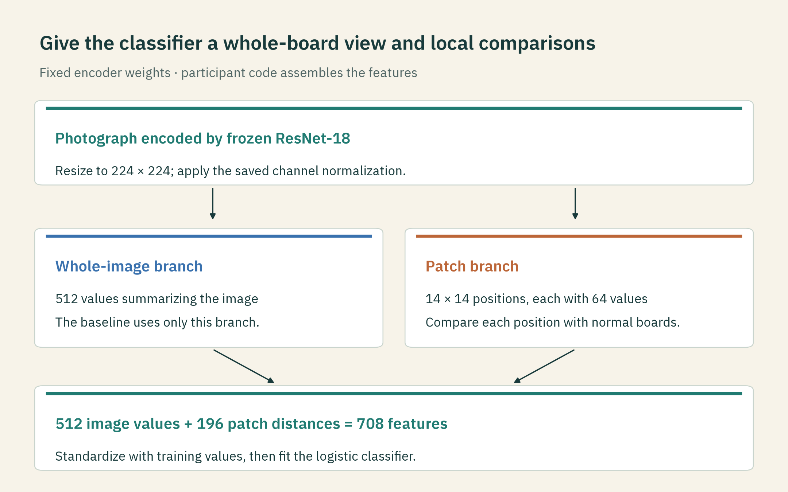
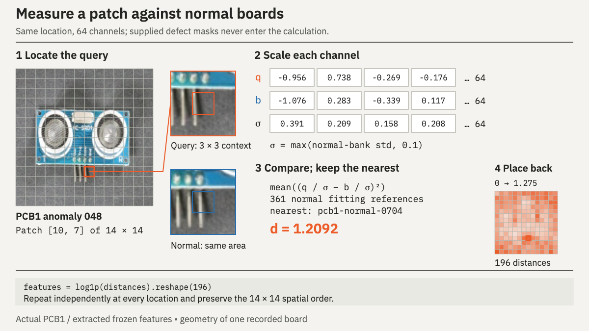
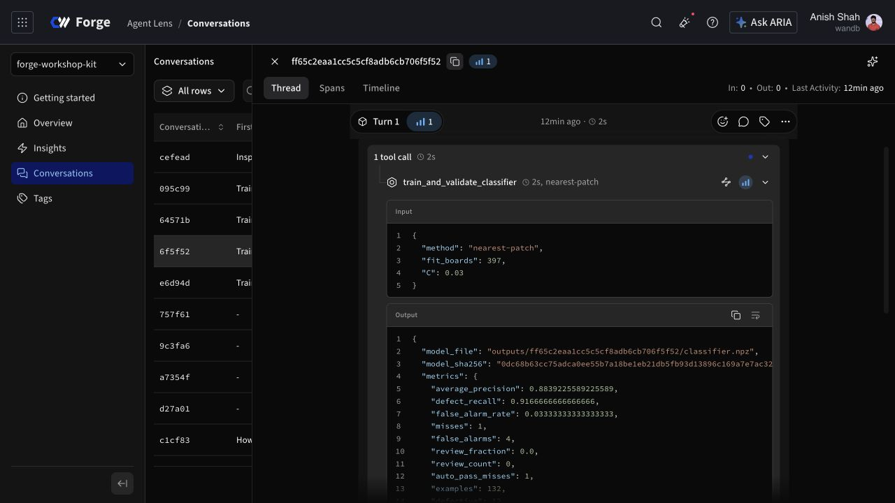
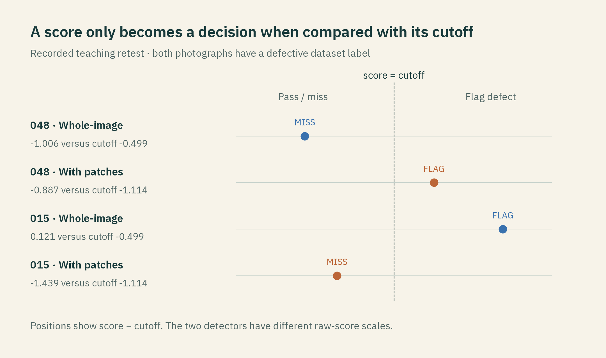
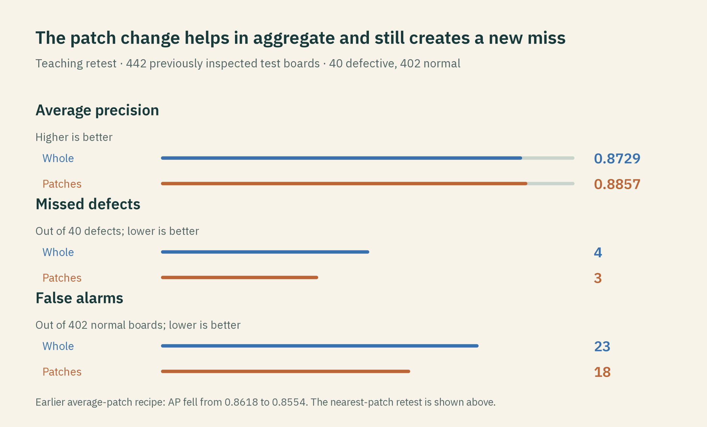
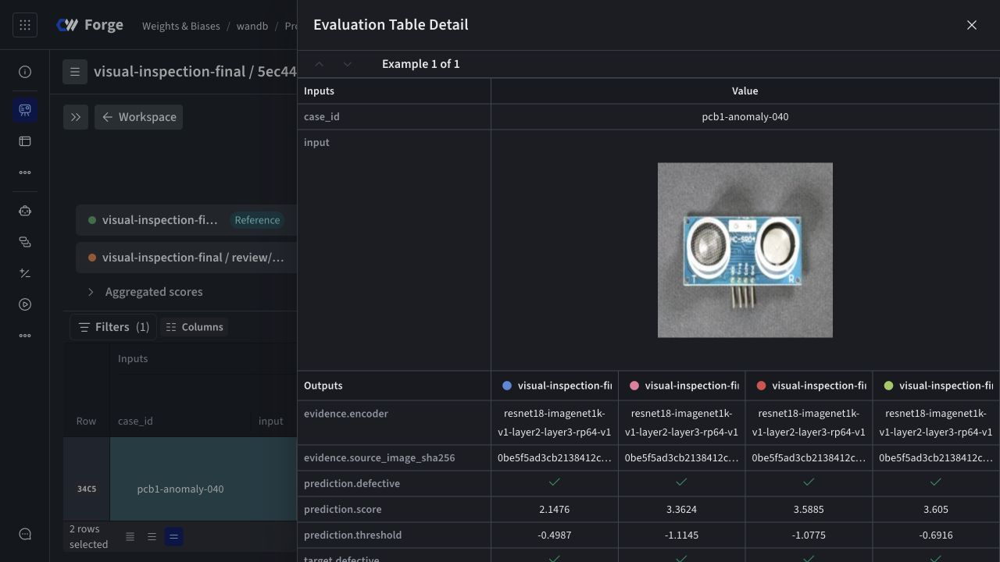

# Find a missed defect, then test the change

Look at the right-hand pin on the board below. The dataset marks that region as defective. Our whole-image detector let the board pass; a second detector using local patch comparisons flagged it. Before celebrating that change, we need to know what reached the classifier, which cutoff produced the decision, and what happened to the other boards.


*Recorded board `pcb1-anomaly-048`. The supplied annotation marks the right-hand header-pin region. Photographs and masks are from VisA, CC BY 4.0. The distance map comes from our feature calculation; it is not a defect mask.*

We built this workshop around a fictional manufacturing team deciding which circuit boards to hold for inspection. The photographs are real observations from [VisA's PCB1 collection](https://github.com/amazon-science/spot-diff/tree/2a692ab575001cbde74d402d897a7286086c6199): 1,004 normal boards and 100 anomalous ones. A detector that misses defects creates one kind of problem. A detector that flags every board creates another queue for the team to work through.

The [editable notebook](https://ash0ts.github.io/forge-workshop-kit/packet/start/inspection.html) lets you build the feature and decision code, investigate mistakes, and compare the same photographs across versions. The board above belongs to the recorded teaching retest. Your notebook starts with development examples before opening its final comparison.

We'll follow one board through the feature calculation, classifier score, and inspection cutoff. Then we'll open its EvalTables row to compare the detector versions and look for boards that changed in the other direction. The selected detector's Artifact includes its reference bank and preprocessing so we can load it again and check that it makes the same decisions.

## Establish what the baseline receives

Our baseline passes each photograph through a frozen ResNet-18 encoder. After resizing to 224 × 224 and applying the saved channel normalization, the encoder produces 512 whole-image values. A class-balanced logistic classifier learns to separate normal and defective boards using those values. Its coefficients change during fitting; the encoder's weights do not.

We preserve VisA's published test partition of 402 normal and 40 anomalous boards. Only the original training partition is split into 397 fitting boards, 133 review boards, and 132 validation boards. The supplied defect masks help us inspect the photos. They never enter feature extraction or classifier fitting.

The notebook supplies versioned features so a CPU can run the exercise without repeatedly encoding the whole collection. You can recompute four retained inputs and compare them with the cache. Saving the encoder weights and preprocessing matters here: changing the resize operation changes the features, even if nobody touched the classifier code.

Run **Train the whole-image baseline** and inspect a validation mistake. The first question is whether its score falls on the wrong side of the cutoff. The next is whether moving that cutoff would fix this case while creating too many errors elsewhere. We introduce the patch alternative after that inspection, so there is an observed problem to investigate.

## Compare local features with normal boards

A small damaged region may be hard to distinguish after the whole photograph has been compressed into one vector. We test an additional representation that retains spatial positions. It produces a 14 × 14 grid, with 64 values at each position, and compares each vector with normal fitting boards at that same position.



*The encoder remains frozen. Participant-written `build_features` controls which values reach the classifier. The defect masks are outside both branches.*

Use the [feature-construction guide](https://ash0ts.github.io/forge-workshop-kit/guides/inspection/representations/index.html) to follow one photograph into the whole-image vector and patch grid. The dimensions explain what the classifier receives before we inspect its score.

Our first recipe compared each patch with the average normal patch at its position. It reduced average precision from 0.861762 to 0.855382. We retained [that failed comparison](https://github.com/ash0ts/forge-workshop-kit/blob/main/evidence/inspection-qualification-v1/results.json). Adding 196 numbers did not, by itself, improve the ranking.

The follow-up compares the query with actual normal patches and retains the closest match. Channel scaling uses variation in the normal reference bank, with a floor to prevent division by a very small value. During fitting, a board cannot select itself as its nearest neighbor.



*One distance is calculated for each of the 196 positions. A bright cell means the encoder representation differs from the normal references. It does not establish which pixels caused the classifier's decision.*

This is the feature assembly you implement. The excerpt shows the nearest-patch branch; the complete notebook function also handles the earlier average-patch method used by its free check.

```python
def build_features(data, rows, method, reference=None):
    whole = data["whole"][rows]
    if method == "whole":
        return whole
    errors = inspection.nearest_patch_errors(data, rows, reference)
    # Compress large distances, keeping one row per board.
    local = np.log1p(errors).reshape(len(rows), -1)
    # Add 196 spatial values to 512 global values: 708 features.
    return np.concatenate([whole, local], axis=1)
```

The 14 × 14 map becomes 196 values. `log1p` compresses large distances before we append them to the 512 whole-image features, producing 708 values per board. Row order stays fixed so each vector still belongs to the correct photograph and label. The same function then supplies the training and prediction inputs.



*Recorded instructor operation. Read the input `method`, `fit_boards`, and `C`, then the output model file and validation errors. This is CPU training recorded as a tool operation, not an LLM deciding whether a board is defective.*

Open [the training operation in Agent Lens](https://forge.coreweave.com/agent-lens/wandb/forge-workshop-kit/conversations/ff65c2eaa1cc5c5cf8adb6cb706f5f52) and check that the configuration belongs to the result you are explaining. Its saved model includes the normal reference bank, feature standardization, coefficients, and cutoff. Without the bank, another notebook could not reproduce these distances.

## Turn a score into an inspection decision

The classifier returns decision values, which can be negative. They are not probabilities. We choose a cutoff using validation, then freeze it before evaluating the test boards.

The exercise selects the largest cutoff that catches at least 90% of validation defects. Validation contains only 12 defects, so the rule must catch at least 11. It does not guarantee 90% recall on future boards. You can inspect the exact errors created by the chosen cutoff before deciding whether that operating point is acceptable for this teaching task.

For board 048, the whole-image score is −1.006, below its cutoff of −0.499. The nearest-patch score is −0.887, above its cutoff of −1.114. Comparing those two raw scores without their cutoffs would hide the changed decision.



*The dashed line marks the decision boundary for each detector. Positions are score minus that detector's cutoff, not calibrated confidence. Both boards have defective dataset labels.*

Board 015 moved the other way. The whole-image model flagged it; the patch model missed it. We keep it beside the recovered case because the manufacturing team receives both outcomes.


*VisA PCB1, CC BY 4.0. The marked solder or header region is small. Bright map regions also appear in the background, which is another reason not to call this map a defect segmentation.*

## Compare the ranking and the operating errors

Average precision asks whether defective boards appear ahead of normal boards as we work down the model's score ranking. Misses and false alarms count the errors at the chosen cutoff. Moving a cutoff can change those counts without changing the ranking.

For the follow-up, both representations selected regularization from the same predeclared grid using validation. We then compared the frozen detectors on the same 442 test boards:



*The average-precision gain is 1.284 percentage points. These test images had already been inspected during the unsuccessful first recipe. This is a teaching retest, not new held-out research evidence.*

The [saved predictions and settings](https://github.com/ash0ts/forge-workshop-kit/blob/main/evidence/inspection-teaching-retest-v2/results.json) support explaining the recovered miss, the new miss, and the aggregate change. They do not qualify an industrial inspection system or establish performance on another board family. The next experiment would need a fresh cohort; we cannot turn these already inspected boards back into unseen evidence by renaming a run.

## Decide which additional labels to acquire

Changing features is one intervention. Acquiring labels is another. The next exercise selects 24 review-pool boards near the cutoff without inspecting their labels, then compares them with a random selection of the same size. Both candidates receive the same labeling budget.

The notebook reveals supplied dataset annotations to simulate obtaining labels. It stores participants' individual assessments separately. We do not describe the full acquired batch as participant-reviewed or assume active selection wins. Select using validation, freeze the choice, and retain the final outcomes even when they favor random selection or the original detector.



*Recorded instructor comparison for `pcb1-anomaly-040`, a different board from 048 and 015. The four outputs include the review variants. The image stays visible beside the values used to make each decision.*

Open [the native EvalTables comparison](https://forge.coreweave.com/wandb/wandb/forge-workshop-kit?nw=h43oxpf30iu), select a board, and find its score and cutoff. Follow the run and artifact links to recover the source, reference bank, standardization, and classifier. That is the reproduction exercise: someone else should be able to obtain the same decision from the files we saved.

## Run the workshop yourself

Download the current [Circuit-board inspection notebook](https://ash0ts.github.io/forge-workshop-kit/packet/notebooks/visual_inspection.py) into a folder you will keep. Follow its [start page](https://ash0ts.github.io/forge-workshop-kit/packet/start/inspection.html) to log in and launch the saved file. The command installs its pinned dependencies and opens an editable local notebook; your results are published to your own Forge project.

The optional [hosted template](https://forge.coreweave.com/notebooks/Tm90ZWJvb2s6MTU5Mjk=/view) remains on v0.11.1 while notebook-management access blocks its update. Use the current download for the revised exercises and direct ARIA controls. The [original v0.12.0 file](https://github.com/ash0ts/forge-workshop-kit/releases/download/v0.12.0/visual_inspection.py) remains available for reproducing that release.

Use **Run all stale cells** to create the controls, inspect the bundled development board, and connect your writable Forge project. Each training operation has its own run button.

The full workshop takes four hours and assumes basic Python. The core exercises use CPU and make no inference API calls; notebook compute is billed separately. The [setup guide](https://github.com/ash0ts/forge-workshop-kit/blob/main/docs/setup.md) includes the laptop path, and the [companion deck](https://ash0ts.github.io/forge-workshop-kit/inspection/) follows the same calculations. Optional ARIA investigations have separate access and usage requirements, with recorded investigations available.

At the first ARIA stop, explain a missed validation board. Is the score close to the cutoff, or do you suspect that whole-image features lose a small defect? Click **Start ARIA investigation**, then **Open ARIA conversation** to discuss the selected photograph and result. **Check ARIA response** brings the answer back into the notebook. Check a cited score or threshold before deciding whether to test a different representation or a different cutoff.

At the closing stop, compare the recovered misses with the new mistakes and false alarms. Include the results of the equal-budget labeling comparison before deciding which detector you would use. Recorded investigations are available if live ARIA is unavailable.

The [Inspection packet](https://utm.io/uuH99) brings together this Report, the deck, notebook, visual guides, and running instructions. Use the recorded board comparison for a short demonstration or fit the detectors in your own project. The materials remain technical previews pending external-account checks and participant rehearsals.
