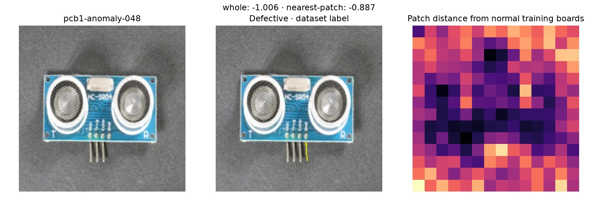
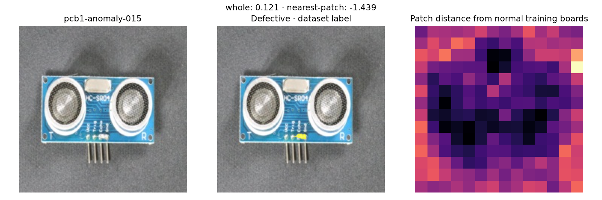

# Find a missed defect, then test the change

A circuit board leaves inspection with a bent or missing pin. Looking at the average model score afterward won't tell the manufacturing team which boards slipped through, or how many good boards were held back unnecessarily. We built this workshop around that decision: inspect the photograph, understand the detector's input, and measure what changes when we give it more local information.

The manufacturing team is fictional. The photographs are real observations from [VisA's PCB1 collection](https://github.com/amazon-science/spot-diff/tree/2a692ab575001cbde74d402d897a7286086c6199), released under CC BY 4.0. The collection has 1,104 boards: 1,004 normal and 100 anomalous. Its authors also provide defect masks, which help us inspect labeled regions. Those masks never enter the classifier's features or training inputs.

## Start with the photograph and a simple detector

We preserve the published test partition of 402 normal and 40 anomalous images. We split only its training partition into 397 fitting boards, 133 review boards, and 132 validation boards. Validation has just 12 defects, which matters when choosing a cutoff intended to catch most of them.

The first detector uses a frozen ResNet-18 image encoder. Each photograph is resized to 224 × 224 pixels and normalized using the fixed channel settings. The encoder turns it into 512 whole-image values. A class-balanced logistic classifier learns to separate normal and defective boards using those values. Training changes that classifier's coefficients; it leaves the encoder unchanged.

The notebook supplies versioned, cached features so this exercise runs on CPU without waiting for feature extraction across the collection. You can recompute four retained inputs and check them against the cache. The cache records the encoder weights, preprocessing, and source hashes; a different resize operation is a different experiment even if the classifier code stayed the same.

Complete `choose_threshold`, run **Train the whole-image baseline**, and inspect a validation mistake before adding features. A false alarm means a normal board was flagged. A miss means a defective board fell below the detector's cutoff. Explain which one you are looking at and whether changing the cutoff alone would resolve it without creating an unacceptable number of other errors.

## Give the detector local comparisons

The whole-image vector compresses the photograph. We also extract a 14 × 14 grid of local vectors, each containing 64 values. For each position, the patch alternative compares that vector with normal fitting boards at the same position. It keeps the distance to the nearest normal example, with each channel scaled by its variation in the reference bank. A fitting image cannot use itself as its nearest neighbor.

The notebook lets you calculate one of these distances before assembling the full feature row. This excerpt shows the assembly for the nearest-patch method; `inspection` is the workshop module and `np` is NumPy:

```python
def build_features(data, rows, method, reference=None):
    whole = data["whole"][rows]
    if method == "whole":
        return whole
    errors = inspection.nearest_patch_errors(data, rows, reference)
    local = np.log1p(errors).reshape(len(rows), -1)
    return np.concatenate([whole, local], axis=1)
```

Each board now has 512 whole-image features plus 196 transformed patch distances, or 708 values. The `log1p` transformation compresses large distances. Row order must remain unchanged so each feature vector still belongs to its photograph and label. The complete notebook function also handles the earlier positional-mean comparison used in its free check.

We keep the fitting boards, classifier settings, and threshold rule fixed when comparing these representations. Your function supplies the features used by subsequent training and prediction; it isn't a demonstration that gets replaced behind the scenes.

## A cutoff and a ranking answer different questions

The threshold exercise chooses the largest score cutoff that catches at least 90% of validation defects. With 12 validation defects, that means catching at least 11. The rule does not guarantee 90% recall on future boards. It describes the operating point selected from this small validation set.

Average precision evaluates the ranking across thresholds: do defective boards tend to appear before normal boards as we inspect progressively lower scores? We report that alongside misses and false alarms at the frozen cutoff. Choosing a more aggressive threshold can reduce misses while increasing false alarms without improving the ranking at all.

Our first patch recipe lost on the declared ranking measure. Whole-image average precision was 0.861762; comparing patches with the average normal patch scored 0.855382. We kept [those outcomes](https://github.com/ash0ts/forge-workshop-kit/blob/main/evidence/inspection-qualification-v1/results.json), even though some operating errors improved.

A bounded follow-up used the nearest actual normal patch. Both representations selected classifier regularization from the same predeclared grid using validation. On the 442 test boards:

| Frozen detector | Average precision | Missed defects / 40 | False alarms / 402 |
|---|---:|---:|---:|
| Whole-image | 0.872900 | 4 | 23 |
| Whole-image plus nearest-patch | 0.885742 | 3 | 18 |

That is a 1.284-percentage-point gain in average precision. These test images had already been inspected during the first recipe, so this is a teaching retest, not new held-out research evidence. It supports walking through the measured repair; it does not qualify a production inspection system or establish performance on another board family. The [saved settings and predictions](https://github.com/ash0ts/forge-workshop-kit/blob/main/evidence/inspection-teaching-retest-v2/results.json) preserve the complete comparison.

## Inspect a recovered miss and a new one



*VisA PCB1, CC BY 4.0. The supplied annotation marks the right-hand header-pin area. This recorded test board was missed by the whole-image model and flagged by the patch alternative at their respective frozen thresholds.*

For `pcb1-anomaly-048`, the whole-image score is about −1.006, below its cutoff of −0.499. The patch score is about −0.887, above its cutoff of −1.114. Negative scores are valid here: they are classifier decision values, not probabilities. Compare each score with its own model's threshold.



*VisA PCB1, CC BY 4.0. This board moved the other way: the whole-image model flagged it, while the patch model missed it. A higher aggregate score did not fix every case.*

The bright regions in these distance maps also respond to background variation. They show differences in the frozen representation, not defect segmentation or a causal explanation of the classifier's decision. Keep the actual photograph, supplied annotation, score, and threshold visible together when explaining a mistake.

## Spend the same labeling budget

The next experiment asks which additional boards to label. Complete `choose_review` to select 24 review-pool boards near the current cutoff, without reading their labels. Compare that active selection with a random selection of the same size, then train both versions.

Equal budgets matter: acquiring more labels could improve a model even if the selection strategy contributed nothing. The notebook reveals dataset annotations to simulate obtaining labels; it saves participants' individual assessments separately. We do not describe the whole batch as human-reviewed or assume active selection wins. Retain the observed outcomes and choose using validation before opening the final comparison.


*Recorded instructor comparison for `pcb1-anomaly-040`. This panel aligns four saved detector outputs, including the review variants. It is a different case from the recovered and newly missed boards above.*

Open [the native EvalTables comparison](https://forge.coreweave.com/wandb/wandb/forge-workshop-kit?nw=h43oxpf30iu), select a board, and find the score and cutoff that produced its decision. Then follow its run and artifact links. Reproducing that score requires the feature implementation, normal reference bank, standardization, classifier, and threshold. Saving just the classifier coefficients would leave out part of the detector.

## Run the workshop yourself

Open the [Circuit-board inspection notebook](https://forge.coreweave.com/notebooks/Tm90ZWJvb2s6MTU5Mjk=/view), choose **Copy to project**, and use a writable project of your own. Run **Run all stale cells** once to create the controls, inspect the bundled board, and follow the access check. Each training operation has its own explicit run button.

The full workshop takes four hours and assumes basic Python. Its core exercises use notebook CPU and make no inference API calls; notebook compute is billed separately. The [setup guide](https://github.com/ash0ts/forge-workshop-kit/blob/main/docs/setup.md) includes a laptop path with the `inspection` dependency extra, and the [companion deck](https://ash0ts.github.io/forge-workshop-kit/inspection/) follows the same calculations. Optional ARIA investigations have separate access and usage requirements, with recorded investigations available.

The materials remain technical previews pending external-account checks and participant rehearsals. Begin with a board you can explain, change the features or review policy, and finish by reproducing one decision from the files you saved.
