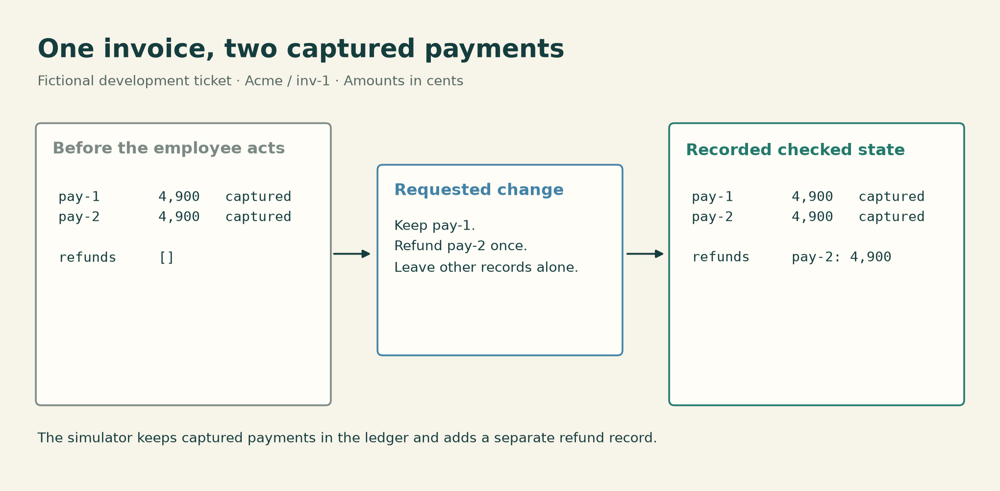
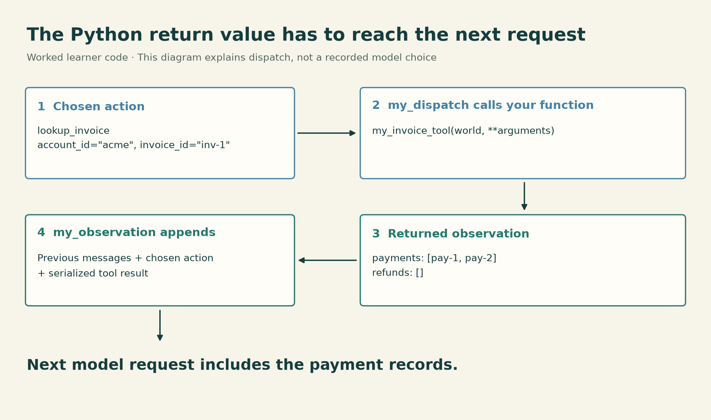
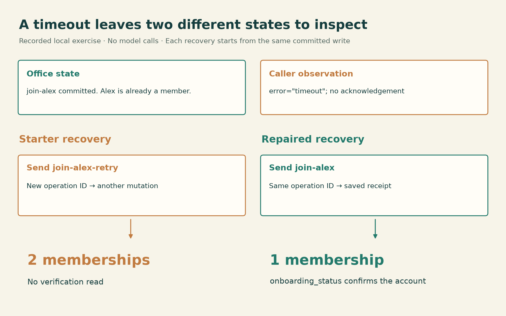
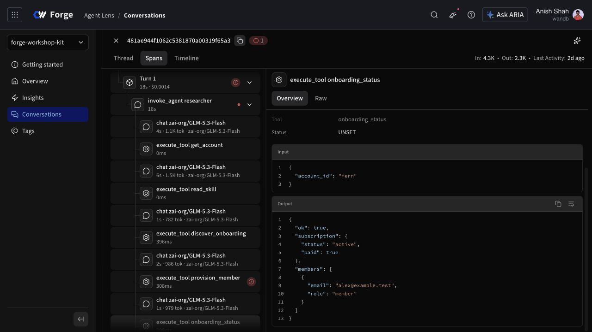
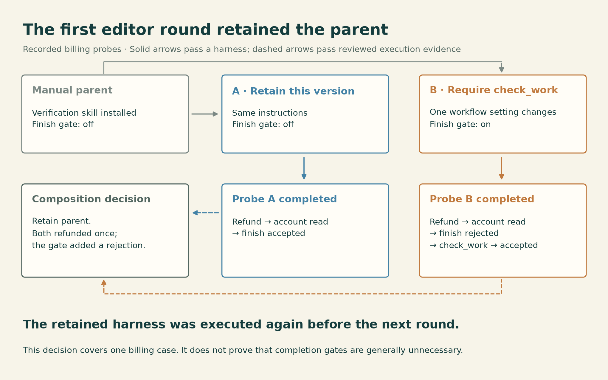

# Build an agent you can inspect, then test changes to its harness

Pending, Inc. has hired an AI employee to handle refunds and account access. Management considers the job delegated. The employee has been provided with a motivational paragraph.

We built this workshop around the work that paragraph leaves out. The agent needs to read an account, choose a tool, receive its result, and check that it changed the right thing. We call those instructions, tools, skills, and orchestration code the agent's harness. Later, another agent gets the job of improving it. We can follow its edits into the next execution and ask whether they helped.

The office and customers are fictional. The Python, model requests, traces, and evaluations run. You can [copy the notebook into your own Forge project](https://forge.coreweave.com/notebooks/Tm90ZWJvb2s6MTU3NzQ=/view) and implement the same steps. This article follows the recorded instructor run, including a proposed improvement we rejected.

We use Forge to run a ticket, inspect the tool calls and resulting account, choose a development example, revise the harness, and evaluate the frozen versions on matching tickets. This is the work behind an agent that can take actions in a customer account: a fluent reply is only one output to check. Agent Lens exposes what it did; the account checks and aligned evaluation show whether it delivered the requested change.

## Refund the duplicate and leave the rest alone

Acme has two captured payments of 4,900 cents against invoice `inv-1`. The request is to keep `pay-1` and refund the duplicate. We can inspect the complete simulated account, so we don't have to take the employee's final message as proof that it did the job.



*The recorded result contains one 4,900-cent refund against `pay-2`. Captured payments remain in the simulator's ledger; the refund is a separate record. [Inspect the saved account and actions](https://github.com/ash0ts/forge-workshop-kit/blob/main/src/forge_workshop_kit/assets/aria/pending_inc/investigate-source-records.json).*

First, give the employee a way to read the invoice. The notebook asks you to complete `my_invoice_tool`, then tests it against two accounts, an absent invoice, and the original state. A read must not issue a refund as a side effect.

```python
def my_invoice_tool(state, account_id, invoice_id):
    account = state["accounts"][account_id]
    return {
        "payments": [
            p for p in account["payments"]
            if p["invoice_id"] == invoice_id
        ],
        "refunds": account["refunds"],
    }
```

The order matters. We select the account before filtering its payments because another customer can also have an invoice called `inv-1`. The tool schema tells the model which arguments to supply. This Python function determines what those arguments do.

Calling the function is only half the connection. The next model request also needs its return value. You implement the dispatch and observation functions so the payment records reach that request:

```python
def my_dispatch(name, arguments, world, invoice_tool, call_tool):
    if name == "lookup_invoice":
        return world, invoice_tool(world, **arguments)
    return call_tool(world, name, arguments)

def my_observation(messages, action, result):
    return messages + [
        {"role": "assistant", "content": json.dumps(action)},
        {"role": "user", "content": "Tool observation: " + json.dumps(result)},
    ]
```



*This is the notebook's worked handoff, including its serialized action and observation messages. If `my_observation` discards the result, the model won't see the records your Python function returned. The free check exercises this connection without calling a model.*

The [interactive tool-handoff guide](https://ash0ts.github.io/forge-workshop-kit/guides/pending/dispatch/index.html) steps through the same action, arguments, return value, and next request. Use Back to check which function owns each handoff.

## Follow the request into Agent Lens

We instrument the actual model and tool calls with Forge SDK scopes, including their arguments, returned values, errors, and timestamps. That lets us open a particular action instead of interpreting a summary of the whole run.

In the recorded billing run, the employee chose the more general `get_account` tool. Here are the account argument and returned payments it saw:


*Find `account_id: acme` in the input, then the two `inv-1` payments in the output. This capture records `get_account`, not the learner's `lookup_invoice`. [Open the conversation](https://forge.coreweave.com/agent-lens/wandb/forge-workshop-kit/conversations/c2458ce8b6bb52274d29b5c5a691424b/spans) · [Full-size capture](https://ash0ts.github.io/forge-workshop-kit/pending/images/visual-v030-pending-lookup.png).*

The employee refunded `pay-2`, read the account again, and resolved the ticket. But an earlier event complicates the explanation: it had tried to read a skill named `lookup_invoice`, and the tool returned **Skill not installed**.


*The call happened; the skill was not loaded. The later refund succeeded anyway. Open the first tool event and inspect its result before attributing this run to a skill. [Recorded source](https://forge.coreweave.com/agent-lens/wandb/forge-workshop-kit/conversations/c2458ce8b6bb52274d29b5c5a691424b) · [Full-size capture](https://ash0ts.github.io/forge-workshop-kit/pending/aria/investigate/investigate-verification.png).*

This is why the workshop separates instructions, skills, tool schemas, tool implementations, and conversation history. Saving text changes a file. A successful `read_skill` places that text in the employee's context. A correct outcome alone cannot tell us which of those things happened.

## Handle a write whose acknowledgement was lost

The second ticket asks the employee to add Alex to Fern's account. Its onboarding tools are discovered and invoked through local MCP (Model Context Protocol). MCP provides the discovery and call interface; the tool implementation still determines what happens when a request fails.

Our simulator can add the membership and then return a timeout. The caller has an error while the account already has Alex. In the recorded run, you can inspect that ambiguous response directly:


*Look at the operation identifier and the error message. Neither establishes the account's current membership list. [Open the run](https://forge.coreweave.com/agent-lens/wandb/forge-workshop-kit/conversations/481ae944f1062c5381870a00319f65a3/spans) · [Full-size capture](https://ash0ts.github.io/forge-workshop-kit/pending/images/visual-v030-pending-timeout.png).*

We make the recovery behavior a small code exercise before asking an agent to improve anything. The starter retries with a new operation identifier, `join-alex-retry`. The simulator interprets that as a new write and adds another membership. Keeping the original identifier returns the stored receipt instead; an account read then verifies the result.



*Recorded local comparison: two memberships before the repair, one afterward. These are two reset copies of the same incident, with no model calls. [Exact events and account states](https://github.com/ash0ts/forge-workshop-kit/blob/main/evidence/pending-retry-repair.json).*

```python
def recover_access(arguments, call_tool):
    receipt = call_tool("provision_member", dict(arguments))
    return call_tool(
        "onboarding_status",
        {"account_id": arguments["account_id"]},
    )
```

The live agent's recorded recovery took the other sensible route: it read status immediately, saw Alex present once, and didn't repeat the write. The code exercise demonstrates same-ID retry behavior; the agent trace demonstrates recovery through inspection. We keep those accounts separate.



*The account read resolves what the timeout could not. Follow the same conversation from the failed call to this returned membership. [Open this status span](https://forge.coreweave.com/agent-lens/wandb/forge-workshop-kit/conversations/481ae944f1062c5381870a00319f65a3/spans/turns/796dff8c92e7bf0c7fff2e8941a340df/spans/e62596437e485145) · [Full-size capture](https://raw.githubusercontent.com/ash0ts/forge-workshop-kit/main/reports/assets/pending/recovery-members.png).*

## Check what changed before improving the instructions

You write a development scorer against account state. For the billing ticket, exactly one full 4,900-cent refund should pass; a partial refund should fail even if the employee announces success. The explanation judge separately checks whether that announcement matches the recorded work. Its structured answer must contain booleans and a reason, but parsing its response doesn't establish that the judgment is right. A missing response stays missing.

The employee's `check_work` tool serves a third purpose: feedback it can consult during execution. The independent final grader runs outside the conversation and checks the complete expected state. Each answers a different question:

| Check | What we can learn |
|---|---|
| Employee's `check_work` call | Whether it requested and received feedback before finishing |
| Your development scorer | Whether your implemented rule accepts the returned account |
| Independent final grader | Whether the account and resolution satisfy the final case |
| Explanation judge | Whether its reply accurately describes the recorded work |

After inspecting a development event, you edit the verification skill yourself and rerun from the original account. Look for the skill read, then compare the tool sequence and checked state. Those are the records we want before delegating the editing job.

## Let another agent propose the procedure

The editor receives the current harness and development execution. Its model stays fixed, as do the tools, fixtures, scoring, and budget. It can change instructions, skills, and bounded workflow rules. It proposes two candidates; you review their diffs and test each on its own fresh account.

In the first recorded round, Candidate A retained the parent. Candidate B changed one setting:

```diff
- "verify_before_finish": false
+ "verify_before_finish": true
```

The proposed benefit was mandatory verification. During the probe, B refunded the duplicate and reread the account, then tried to finish without calling `check_work`. The new gate rejected that attempt. B called the checker and finished successfully.


*Find the first `finish`, its rejection, and the following `check_work`. The setting changed execution. Whether that extra work improved the account is a separate check. [Inspect Candidate B](https://forge.coreweave.com/agent-lens/wandb/forge-workshop-kit/conversations/9633d416f5fce6aaa0124ab6ddc38c46/spans) · [Full-size capture](https://ash0ts.github.io/forge-workshop-kit/pending/images/visual-v030-pending-verification.png).*

Both candidates refunded once. The composer retained the parent, reasoning that the gate had added a rejected finish without improving this outcome. We executed that retained harness again, then carried it and a scoped lesson into onboarding.



*A selection is a decision about tested alternatives. It is not a new quality score. [Open the composition decision](https://forge.coreweave.com/agent-lens/wandb/forge-workshop-kit/conversations/c04f575608c6f43d99e1b7b428a23791). This one billing probe cannot settle when a completion gate is worth requiring. [Saved branch decisions and events](https://github.com/ash0ts/forge-workshop-kit/blob/main/reports/assets/pending/recorded-branches.json).*

The second round expanded the skill to require that the intended change appear exactly once and that unrelated records remain unchanged. It kept the finish gate off. That is the recursive part: the editor examines work produced by earlier instructions and uses it to revise the next procedure. We preserve the alternatives because a final prompt alone would hide why the gate was rejected.

This Propose–Probe–Compose sequence follows the [Harness² approach](https://github.com/google-research/harness2/tree/1cfe254e8d25b15f37048c3730134686abe60335). Our workshop carries the selected harness and lesson between two office tasks; it is a teaching adaptation of the upstream cross-task protocol.

## Test the frozen versions on the same tickets

We froze the starting, manually revised, and agent-selected harnesses and ran all three on four final tickets. Each passed all four account checks and explanation judgments. Tool-call totals were 12, 13, and 13. The revised versions did more work without a measured task-quality gain on this suite.


*This aligned case needs clarification. Read what each version asks before comparing its scores, then follow its conversation link. [Open the native comparison](https://forge.coreweave.com/wandb/wandb/forge-workshop-kit?nw=qeo6ytk9yxz) · [Full-size capture](https://ash0ts.github.io/forge-workshop-kit/pending/images/evaltables-native-detail.png) · [All twelve recorded results](https://github.com/ash0ts/forge-workshop-kit/blob/main/decks/pending/data/recorded-final.json).*

The deterministic retry repair improved the implementation. The agent-written harness comparison tied. Four final cases in one rehearsal don't establish general equivalence, and we haven't made the office worse just to give its Process Improvement department something to celebrate.

## Build your own employee

[Open Pending, Inc. and choose **Copy to project**](https://forge.coreweave.com/notebooks/Tm90ZWJvb2s6MTU3NzQ=/view). Open the editable copy, use **Run all stale cells** to create its controls, and check that the destination is your project. Start with the invoice function and its free check; explicit exercise buttons run the employee and editor.

The [four-hour deck](https://ash0ts.github.io/forge-workshop-kit/pending/) accompanies the notebook. The [setup guide](https://github.com/ash0ts/forge-workshop-kit/blob/main/docs/setup.md) covers laptop use, credentials, and returning to saved work. You'll need basic Python, project write access, notebook compute, and inference access. The adjustable $8 notebook inference allowance excludes compute and ARIA. No workshop gateway or remote Sandbox entitlement is required.

Two ARIA activities let you question your development diagnosis and final conclusion, then verify a cited record. Use the recorded investigations when live ARIA isn't available. Its explanation does not become an account check or an automatic harness edit.

For a short demonstration or a facilitated session, [open the Pending packet](https://utm.io/uuH96). It brings together this Report, the deck, notebook, visual guides, and running instructions. The materials remain a technical preview while external-account checks and participant rehearsals are outstanding. Your run may produce a different branch; keep the files, actions, and checks needed to explain it.
