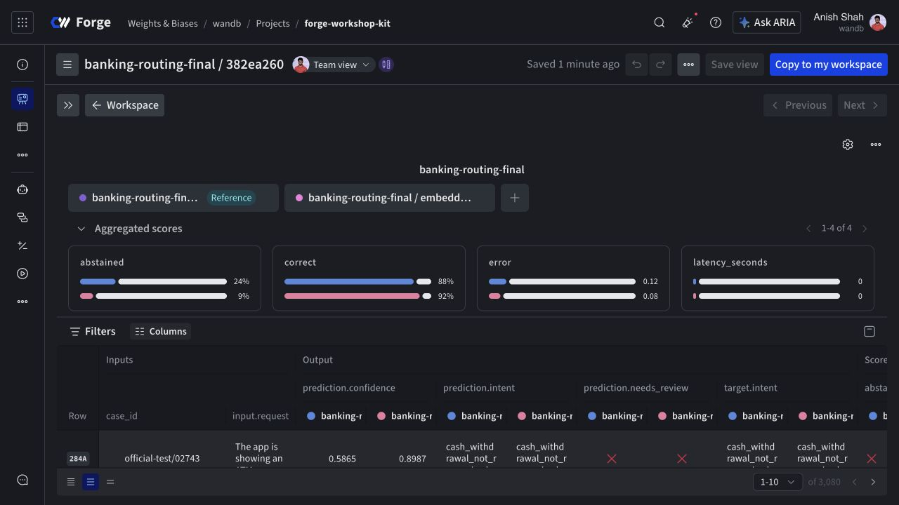
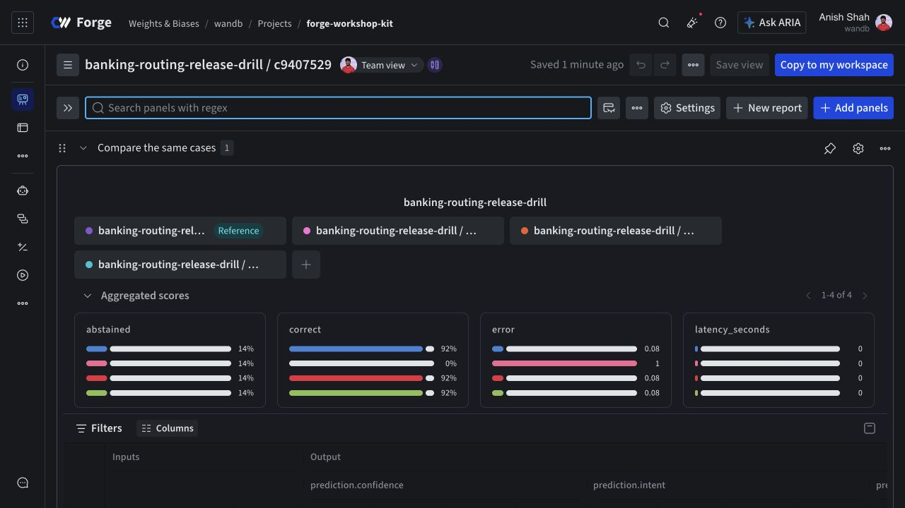

# Train a support router, then check what you released

A customer asks, “What is the status of my card's delivery?” Someone has to send that request to the right support workflow. A card that hasn't arrived needs a different response from a card that arrived but doesn't work. We built this workshop around that small decision because it lets us follow the whole job: train a classifier, inspect its mistakes, review uncertain requests, and check that the saved model still works after loading it somewhere else.

The support desk is fictional. The messages come from [Banking77, a public dataset of banking-support requests](https://github.com/PolyAI-LDN/task-specific-datasets/tree/57ec275d8078af65b7731c2a98be812d844a6d6b/banking_data) by Casanueva and colleagues at PolyAI, released under CC BY 4.0. Its 77 intent labels name the workflows the router can choose. The opening request is a training-derived review example labeled `card_arrival`. Nothing in this exercise accesses a bank account or takes a financial action.

## Give the classifier something to learn from

We start with word features. TF–IDF assigns values to words and adjacent word pairs, giving less weight to terms that appear throughout the collection. A logistic classifier learns how those values relate to the intent labels.

The notebook asks you to complete this constructor, then fit a tiny practice dataset before training on the support requests:

```python
def make_classifier():
    from sklearn.linear_model import LogisticRegression
    return LogisticRegression(C=10, max_iter=1000, random_state=17)
```

Creating this object doesn't train it. The workshop calls `fit` with the training features and labels. Later, `predict_proba` returns one probability column for each intent in `model.classes_`. Keeping that column order will matter when we release the model.

We split the official training partition before fitting anything: 8,463 messages for training, 770 for validation, and 770 for review. The official 3,080-message test set stays separate. Validation lets us inspect mistakes while deciding what to change; the review pool provides examples we can explicitly label and add to training.

Run **Train the word-feature baseline**, select a validation request, and explain its prediction. Only then try **Train the sentence-feature alternative**. This second version gives the same classifier 384-value vectors from a frozen sentence encoder. The encoder's weights stay fixed; the classifier learns new coefficients on those features. We are changing the representation, not fine-tuning a language model.

## Measure routing quality and review load separately

A classifier can look accurate by sending its difficult cases to people. We therefore report both the fraction routed automatically, called coverage, and accuracy among those routed requests. We also score the predictions for the complete test set.

Macro-F1 calculates F1 for each intent and averages across all 77. F1 combines precision, which asks whether requests sent to an intent belong there, with recall, which asks how many of that intent's requests we found. For the recorded `card_arrival` predictions, 34 true positives, three false positives, and six false negatives give F1 = 68 / 77, about 0.883. That is one intent's score, not the overall result.

With the data and classifier settings fixed, the recorded final comparison was:

| Input representation | Macro-F1 | Automatically routed at 0.5 | Accuracy among routed requests |
|---|---:|---:|---:|
| Word TF–IDF | 0.879385 | 75.84% | 96.06% |
| Frozen sentence embeddings | 0.920229 | 91.10% | 96.15% |

The sentence representation improved macro-F1 by 4.0844 percentage points and routed more requests at the same cutoff. Seeds 17, 29, and 43 reproduced identical predictions because this fitting procedure is deterministic. They are reproducibility checks, not independent experiments or an uncertainty estimate. The [recorded protocol and outcomes](https://github.com/ash0ts/forge-workshop-kit/blob/main/docs/routing-workshop.md#what-qualification-showed) retain that distinction.



*Recorded instructor results in Forge. The bars summarize accuracy and abstention; they do not display macro-F1. Open an individual row to see the request behind a disagreement.*

In [the recorded EvalTables comparison](https://forge.coreweave.com/wandb/wandb/forge-workshop-kit?nw=fthby6owcpo), find a request where the classifiers disagree. Compare its target intent, both predictions, and whether either version deferred to review. A larger confidence value is not a calibrated guarantee of correctness. Cached embedding timings also omit the encoder's forward pass, so they aren't end-to-end service latency.

## Review mistakes before automating the review

The notebook separates two questions: whether to route a request now, and which examples to label for another training run. The first uses a confidence cutoff. The second ranks review-pool requests by the margin between their two highest probabilities. A narrow margin tells us the classifier has competing destinations; it doesn't tell us which destination is correct.

Read the request, save your accepted label, and retain the model's proposal separately. Only explicitly verified human-review records extend training. Then write the automated reviewer's rubric and its response validator. Requiring a real boolean and a nonempty reason catches malformed output. It cannot establish that the judgment is right.


*The recorded judge accepted `activate_my_card`; the dataset reference is `card_linking`. The response has the expected structure, but the disagreement still needs examination. The screenshot clips part of the reason; the linked conversation retains the response.*

Open [that Agent Lens conversation](https://forge.coreweave.com/agent-lens/wandb/forge-workshop-kit/conversations/f5427dc7f06703d62c00561b6bd27a01) and read the request before accepting either label. Three of four recorded judge decisions matched the dataset references. This small exercise demonstrates investigation, not a qualified automated labeling system. The separate eight-request prompted-router exercise teaches instrumentation; it isn't the 3,080-request classifier benchmark. Missing judgments remain unavailable.

## Release the whole predictor

We deliberately introduce a loading defect after choosing the classifier. The loader rotates the intent names while leaving the probability columns unchanged. A request can retain exactly the same confidence and still reach the wrong queue. Checking that all 77 names exist won't catch it.

The repair preserves order and tests both contracts:

```python
def label_names(model_classes):
    return list(model_classes)

def check_release(model_classes, loaded_labels):
    return {
        "label_set": set(model_classes) == set(loaded_labels),
        "label_order": list(model_classes) == list(loaded_labels),
    }
```

The release artifact contains the fitted classifier, preprocessing identity, label order, review policy, and source. We reload its exact version and compare predictions on 77 fixed review-pool requests, one per intent. This is a regression and reproduction set, not another independent test set.



*This is a controlled drill. In order, the bars show healthy, faulty, repaired, and rollback. The faulty loader preserves review coverage while routing every request incorrectly.*

In the [recorded drill](https://forge.coreweave.com/wandb/wandb/forge-workshop-kit?nw=37umm80le0d), the healthy version routed 71/77 correctly; the faulty version scored 0/77. The repair restored all 77 original predictions, and reloading the previous artifact reproduced them during rollback. Six classifier mistakes remained. Repairing the loader restored the measured model behavior; it didn't improve the model. The capstone required no additional training or model API calls.

## Run the workshop yourself

Open the [Customer request routing notebook](https://forge.coreweave.com/notebooks/Tm90ZWJvb2s6MTU5Mjg=/view), choose **Copy to project**, and select a project where you have write access. Use **Run all stale cells** once to create the controls, confirm the displayed destination, and start with the bundled request. Training and model calls have separate, explicit run buttons.

The [setup guide](https://github.com/ash0ts/forge-workshop-kit/blob/main/docs/setup.md) includes the laptop path and recovery instructions; the [companion deck](https://ash0ts.github.io/forge-workshop-kit/routing/) follows the same exercises. Allow five and a half hours for the full workshop. You need basic Python, notebook compute, and your own inference access for the prompted routing and judge activities. The adjustable $8 inference allowance is separate from compute and ARIA usage.

These are published technical-preview materials; external-account checks and participant rehearsals remain outstanding. Your copy saves your edits and results. Start by explaining one wrong route, then finish by reproducing the exact predictor you chose to release.
