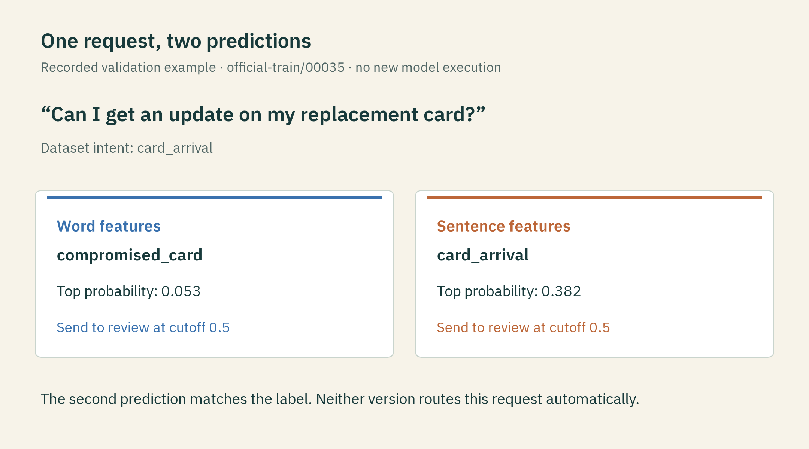
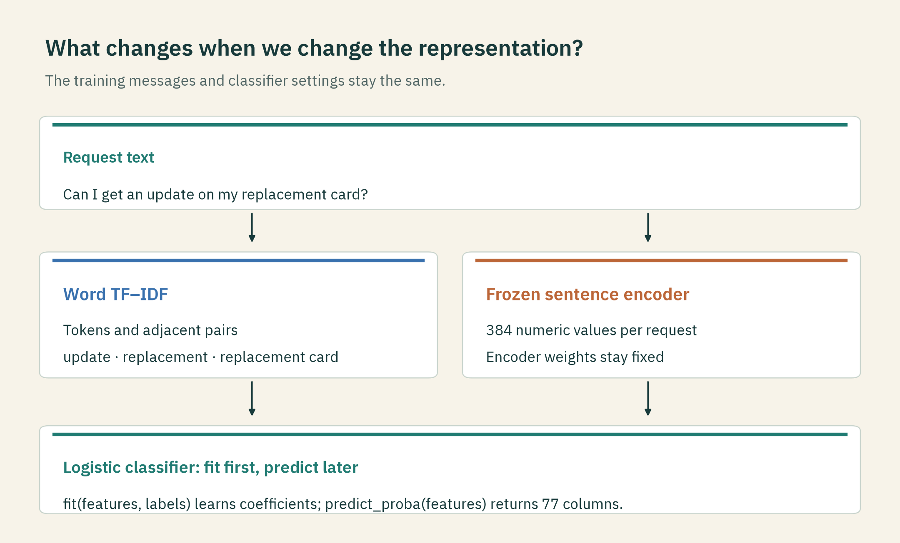
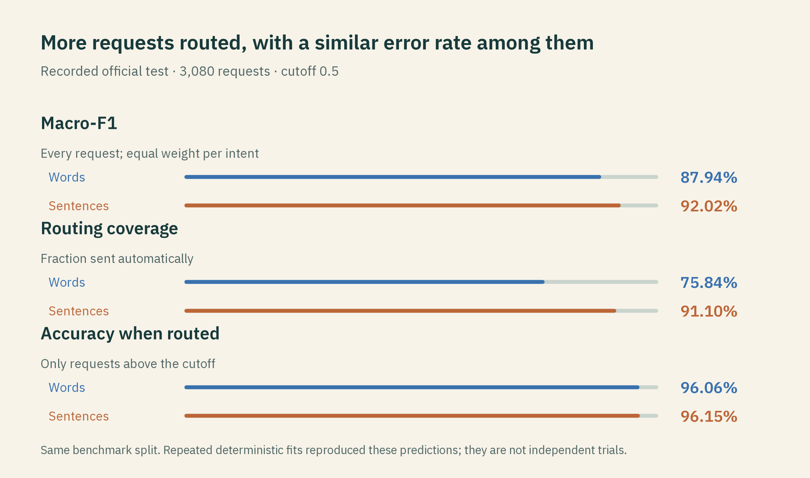
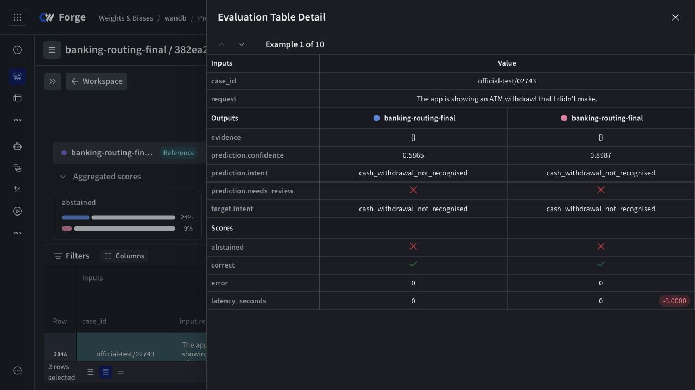
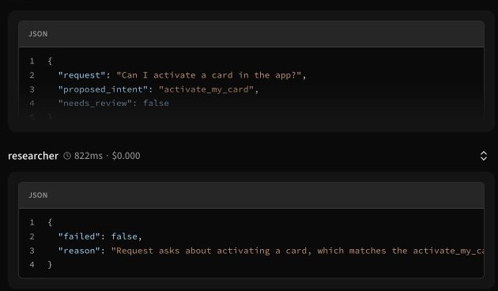
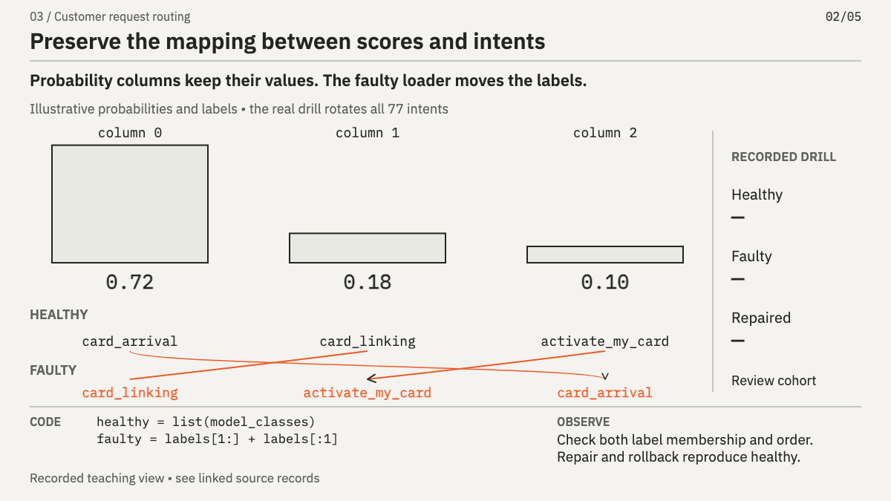

# Train a support router, then check what you released

“Can I get an update on my replacement card?” is an ordinary support request. The customer wants to know where their card is. Sending them to the compromised-card workflow would give the next system the wrong job before it has even started.

Our first classifier made that prediction. A second classifier, trained on sentence representations, chose `card_arrival`, which matched the dataset label. Both still sent the request to a person because their probabilities fell below the automatic-routing cutoff. That gives us three things to inspect: the representation, the prediction, and the decision to act on it.



*Recorded validation request `official-train/00035`. The second classifier changes the proposed destination. It does not automatically route this particular request.*

We built this workshop to follow those decisions through training, review, evaluation, and release. The support desk is fictional; the messages come from [Banking77](https://github.com/PolyAI-LDN/task-specific-datasets/tree/57ec275d8078af65b7731c2a98be812d844a6d6b/banking_data), a public collection from Casanueva and colleagues at PolyAI, released under CC BY 4.0. Its 77 intent labels distinguish requests such as a card that has not arrived, a card that does not work, and a transaction the customer does not recognize.

You can [open the notebook and use your Forge project](https://ash0ts.github.io/forge-workshop-kit/packet/start/routing.html) and build the same comparison. The examples below are saved instructor results, so you can investigate them before running your own version.

We'll compare the same message across classifiers in EvalTables and inspect the probability assigned to each proposed destination. Then we'll load the selected model from an Artifact and run a batch of requests in the notebook. A controlled loading bug changes the intent mapping while leaving those probabilities untouched. Finding and repairing that bug is the second part of the workshop: a good classifier can still send a request to the wrong queue if we load it incorrectly.

## Change what the classifier can see

A classifier needs numbers as inputs. We start by turning words and adjacent word pairs into TF–IDF features. A term's value depends on its frequency in the request and how common it is across the training collection. For the request above, the feature vocabulary can include `replacement` and `replacement card`. These features preserve word occurrence; they do not directly encode the meaning of asking for a delivery update.

The alternative passes the message through a frozen sentence encoder and produces 384 numbers. We then train the same kind of logistic classifier on those vectors. The encoder's weights stay fixed. The classifier learns coefficients that map the new representation to the 77 intents.



*We change the input representation while retaining the training messages and classifier settings. The displayed tokens are an illustrative subset, not an explanation of which feature caused the saved mistake.*

The [request-to-features guide](https://ash0ts.github.io/forge-workshop-kit/guides/routing/features/index.html) follows the same message through the two representations and their probability columns. Keep the message fixed while comparing what changes.

The first code change is small:

```python
def make_classifier():
    from sklearn.linear_model import LogisticRegression
    return LogisticRegression(C=10, max_iter=1000, random_state=17)
```

Returning the estimator does not train it. In the notebook's free check, you call `fit` on four practice points and inspect `predict` before running the support dataset. The full training step learns from 8,463 messages. Another 770 messages form validation, 770 form the review pool, and the original 3,080-message test set remains separate.

Run **Train the word-feature baseline** and inspect a validation mistake before trying **Train the sentence-feature alternative**. For our replacement-card request, the saved word-feature model assigned `compromised_card` a probability of 0.053. The sentence-feature model assigned `card_arrival` 0.382. We can say that this request's prediction changed and matched the reference. Determining why it changed would require examining the learned features and weights; a plausible story about the word *replacement* is not that examination.

## Decide which requests can skip review

The notebook's routing policy compares the largest probability with a cutoff:

```python
def needs_review(confidence, threshold):
    # Below the cutoff means send to human review.
    return confidence < threshold
```

At 0.5, both predictions above go to a person. Raising the cutoff can increase accuracy among automatically routed requests by withholding harder ones. It also sends more work to the support team. We therefore retain the underlying predictions and report routing coverage alongside correctness.

Macro-F1 answers another question. We calculate precision and recall for each intent, combine them into its F1 score, then average across all 77 intents. For the recorded `card_arrival` predictions, 34 true positives, three false positives, and six false negatives give F1 = 68 / 77, about 0.883. That is one intent's result. The overall metric includes the other 76, even if we are more interested in the card request on screen.

With the test messages and classifier settings fixed, this was the final comparison:



*The sentence representation improved macro-F1 by 4.0844 percentage points and routed more requests at the same cutoff. Seeds 17, 29, and 43 reproduced identical predictions because these fits are deterministic. They do not provide an uncertainty estimate.*

The [saved protocol and outcomes](https://github.com/ash0ts/forge-workshop-kit/blob/main/docs/routing-workshop.md#what-qualification-showed) include every prediction. Cached embedding timings omit the encoder's forward pass, so we do not present them as end-to-end service latency. The probabilities are also uncalibrated; 0.9 is not a verified promise of 90% correctness.


*Recorded instructor comparison. In this native view, the `correct` bars show accuracy, not macro-F1. The `abstained` bars show how often the policy asks for review.*

Open [the EvalTables comparison](https://forge.coreweave.com/wandb/wandb/forge-workshop-kit?nw=fthby6owcpo) and expand a request. The row keeps the text, reference intent, both predictions, and their review decisions together. A score difference is easier to interpret when we can read the work being scored.



*This separate test request is a tie in correctness. The higher probability did not improve the destination: both versions already sent it to `cash_withdrawal_not_recognised`.*

## Review a label before teaching a judge to accept it

The routing cutoff decides whether to act now. The review-selection exercise decides which examples we should spend labeling effort on. It ranks review-pool requests by the gap between their two highest probabilities. A small gap identifies competing destinations, but it doesn't tell us which one is right.

Participants read selected messages, save their accepted labels, and retain the classifier's proposals separately. Only explicitly verified review records can extend training. We then ask a model-based reviewer to judge proposals using a written rubric and compare its answers with those reviews.

One recorded example makes the limits of that process concrete. For “Can I activate a card in the app?”, the classifier proposed `activate_my_card`. The automated reviewer agreed. The dataset's reference label is `card_linking`.



*The output passes the expected schema and still disagrees with the dataset reference. The screenshot clips part of the explanation; [the full conversation](https://forge.coreweave.com/agent-lens/wandb/forge-workshop-kit/conversations/f5427dc7f06703d62c00561b6bd27a01) retains it.*

This request deserves inspection before we declare either interpretation correct. The reviewer sees the request, proposed intent, and rubric. It does not see the participant's accepted label. Requiring a boolean `failed` field and a nonempty `reason` catches malformed responses; it cannot validate the reasoning inside them.

Three of four recorded judge decisions matched the dataset references. That is a small investigation exercise, not a qualified automated labeling system. The separate eight-request prompted-router exercise teaches model-call instrumentation and should not be confused with the full classifier evaluation. Unavailable judgments stay unavailable.

## Preserve the meaning of each probability when releasing

After choosing a classifier, we introduce a controlled loading defect. The fitted model returns its probabilities in the order specified by `model.classes_`. The faulty loader rotates the label names while leaving those probability columns untouched:

```python
# Deliberately faulty code for the release drill.
labels = list(model.classes_)
loaded_labels = labels[1:] + labels[:1]
```

The confidence looks exactly as reassuring as before. It now belongs to the wrong queue. This is an unglamorous release bug, which is why we wanted it in a workshop that could otherwise finish at a good-looking model score.



*This diagram uses the notebook's three-label free check. Its probabilities are symbols. The real drill rotates all 77 intent names; checking that the same names are present will not detect the permutation.*

Participants write both the repair and the check:

```python
def label_names(model_classes):
    # Probability column i must keep its corresponding class name.
    return list(model_classes)

def check_release(model_classes, loaded_labels):
    return {
        "label_set": set(model_classes) == set(loaded_labels),
        # Membership can pass even when probability columns have wrong names.
        "label_order": list(model_classes) == list(loaded_labels),
    }
```

The release artifact contains the fitted classifier, preprocessing identity, label order, review policy, and source. We reload an exact version and run 77 fixed review-pool requests, one per intent. These are reproduction and regression checks, not another independent test set.


*Controlled drill, with bars ordered top to bottom: healthy, faulty, repaired, rollback. The healthy version gets 71/77 correct; the rotated mapping gets 0/77. Repair restores all 77 healthy predictions, including the six existing classifier errors.*

In [the recorded release comparison](https://forge.coreweave.com/wandb/wandb/forge-workshop-kit?nw=37umm80le0d), compare the prediction and review flag for the same request across versions. Then open the [faulty batch in Agent Lens](https://forge.coreweave.com/agent-lens/wandb/forge-workshop-kit/conversations/568a4b3aef6af0258bb2a96ab1b4026c) to inspect the failed ordering check. Reloading the previous artifact reproduced its predictions during rollback. No additional training or model API calls were needed for this capstone.

## Run the workshop yourself

Download the current [Customer request routing notebook](https://ash0ts.github.io/forge-workshop-kit/packet/notebooks/request_routing.py) into a folder you will keep. Follow its [start page](https://ash0ts.github.io/forge-workshop-kit/packet/start/routing.html) to log in and launch the saved file. The command installs its pinned dependencies and opens an editable local notebook; your results are published to your own Forge project.

The optional [hosted template](https://forge.coreweave.com/notebooks/Tm90ZWJvb2s6MTU5Mjg=/view) remains on v0.11.1 while notebook-management access blocks its update. Use the current download for the revised exercises and direct ARIA controls. The [original v0.12.0 file](https://github.com/ash0ts/forge-workshop-kit/releases/download/v0.12.0/request_routing.py) remains available for reproducing that release.

Use **Run all stale cells** to create the controls, enter your writable Forge project, and inspect the bundled request. Training and model calls have separate run buttons.

The [setup guide](https://github.com/ash0ts/forge-workshop-kit/blob/main/docs/setup.md) includes the laptop path and recovery instructions. The [companion deck](https://ash0ts.github.io/forge-workshop-kit/routing/) follows the same exercises. Allow five and a half hours and bring basic Python familiarity. The adjustable $8 inference allowance covers the notebook's model calls; compute and optional ARIA usage are separate.

At the first ARIA stop, explain why you think TF–IDF chose its destination for a validation request. Click **Start ARIA investigation**, then **Open ARIA conversation** to ask about the selected prediction and model. **Check ARIA response** brings the answer back into the notebook. Check its explanation against the request and classifier scores before deciding what a different representation might help with. A recorded investigation is included if live ARIA is unavailable.

The closing investigation returns to the release drill. Check that the repaired loader restores the original intent mapping, then identify the requests the classifier still gets wrong. Those remaining errors need a different intervention from the loading repair.

Watch the [routing and release walkthrough](https://ash0ts.github.io/forge-workshop-kit/walkthrough/#routing) to follow a probability column through the mapping defect and aligned request comparison.

The [Routing packet](https://utm.io/uuH98) collects this Report, the deck, notebook, visual guides, and running instructions for a short demonstration or the full session. These remain technical-preview materials; external-account checks and participant rehearsals are outstanding. Your copy saves your edits and results, including the remaining classifier errors after the loading bug is repaired.
