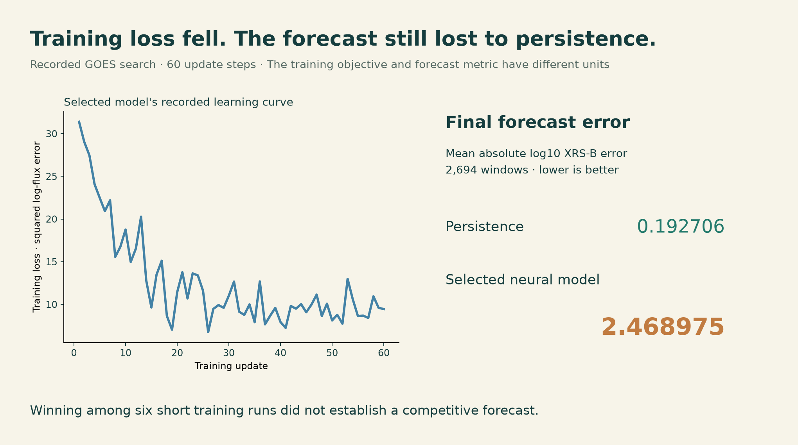
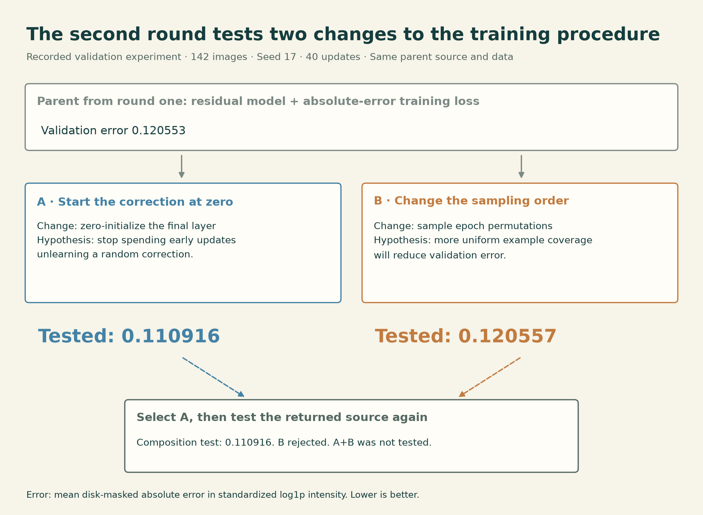

# Test research-agent changes against real solar observations

Our research lab is preparing two solar forecasts: X-ray flux 30 minutes ahead and an image of the Sun one hour ahead. At the weekly review, someone brings a lower error score. There are four notebooks named `final`, and none contains quite the code that produced it. Before deciding whether to keep the model, we have some reconstructing to do.

We built Solar Autoresearch to make that reconstruction part of the experiment. You prepare a forecast, save the code and outputs that produced it, inspect its mistakes, and test a change. Then you give a research agent the same job. Its proposals become Python diffs and training runs that we can review, rather than another explanation of why its idea should work.

The lab is fictional. Its satellite observations are real, and the recorded experiments include a neural forecast that failed badly, a repair, and an image change that helped two seeds and hurt a third. You can [copy the notebook into your Forge project](https://forge.coreweave.com/notebooks/Tm90ZWJvb2s6MTU3NzU=/view) and run the small experiments on CPU.

Forge connects the evidence we need for that review. Runs and Sweeps retain the settings and learning curves; Artifacts retain the data, source, weights, and predictions. Agent Lens records the research agent's requests and edits. We select changes using validation, then compare frozen forecasts on matching observations in EvalTables. That makes agent-assisted research an experiment we can question, including when it fails to improve the forecast.

## Define the forecast before training a model

We start with GOES-15 X-ray measurements, sampled once a minute. Given the previous hour, predict XRS-B flux 30 minutes ahead. XRS-B measures irradiance in watts per square metre over a particular X-ray band. We transform flux with log10 because its scale varies substantially; the prediction and score stay in those log-flux units.

The teaching data cover February 1–14, 2014. Days 1–10 train the models, 11–12 select changes, and 13–14 supply the original final comparison. A window cannot cross a partition boundary or a data gap. The missing February 8 GOES file remains missing, and normalization is fitted only on training observations. Choosing a split is also choosing what information the model and researcher are allowed to use.


*At this forecast origin, the model receives the history to the left and must predict the orange point to the right. The graph undoes input standardization to show log10 flux. [Full-size window](https://ash0ts.github.io/forge-workshop-kit/solar/images/v031-goes-window.png) · [Data, units, preprocessing, and source credits](https://github.com/ash0ts/forge-workshop-kit/blob/main/docs/solar-contract.md).*

Step through the [forecast-window guide](https://ash0ts.github.io/forge-workshop-kit/guides/solar/window/index.html) to separate the history, transformation, and future target before implementing the predictor.

Before training, we ask how well the most recent reading predicts the future. Persistence simply carries that reading forward. The prepared data already retain it in target units:

```python
def persistence_forecast(split):
    return split["persistence"].copy()

def my_flux_mae(prediction, target):
    return float(np.abs(prediction - target).mean())
```

You implement these functions and run free checks that catch future-target leakage and signed errors cancelling one another. Then compare a small multilayer perceptron, which flattens the history, with a temporal convolutional network (CNN), whose filters move across it. Their forward-pass checks show the input and output shapes before you spend time training.

## A falling learning curve can still produce a poor forecast

The notebook trains one configuration first. We inspect its learning curve, then finish the remaining five configurations through W&B Sweeps. Training changes forecasting weights; validation measures predictions without updating those weights.

In the original recording, all six configurations received only 60 update steps. The selected model's training loss fell, but its final forecast error was **2.468975**, against persistence at **0.192706**. Lower is better. Selecting the best configuration in that Sweep had not made it competitive with copying the last reading.



*The left axis is squared training loss; the right values are mean absolute forecast error. Their magnitudes are not directly comparable. Both come from the same saved model. [Learning curve and exact run records](https://github.com/ash0ts/forge-workshop-kit/blob/main/decks/solar/public/recorded-study.json) · [Open the six-run Sweep](https://forge.coreweave.com/wandb/wandb/forge-workshop-kit/sweeps/pzigourv).*

We later tested a persistence-residual model with consistent prediction/target scaling, absolute-error loss, a zero-initialized output layer, and a longer bounded training budget. The fixed recipe scored **0.162878, 0.163880, and 0.163760** across seeds 17, 29, and 43, below persistence in each case. The changes were tested together, so we cannot assign that gain to one of them.

Those final dates had already been inspected. We call this a [teaching retest](https://github.com/ash0ts/forge-workshop-kit/blob/main/docs/solar-qualification.md), and keep the failed original run. A repair is worth examining without pretending we've found another unseen test set.

## Predict a change in the solar image

The image task gives us something spatial to inspect. We use real AIA 171 Å observations from NASA's Solar Dynamics Observatory: one image from an hour ago and one from now, with the image an hour ahead as the target. SunPy supports acquisition and FITS inspection. Our prepared arrays are 64 × 64, so the required models remain small enough for CPU exercises.


*The two left frames are inputs; the future frame is the target. These are satellite observations, not generated images. Exposure correction, spatial averaging, training-fitted log1p scaling, checksums, and attribution to NASA/SDO, AIA, JSOC, and SunPy are recorded in the [data contract](https://github.com/ash0ts/forge-workshop-kit/blob/main/docs/solar-contract.md). [Full-size images](https://ash0ts.github.io/forge-workshop-kit/solar/images/v030-image-window.png).*

A direct convolutional model predicts the whole future image. A residual model predicts a correction and adds it to the current frame:

```python
# Abbreviated forward pass; x holds earlier and current frames.
correction = self.net(x)
prediction = x[:, 1:2] + correction
```

The addition matters. If the correction is zero, the model produces persistence. The network can learn where and how much to depart from that baseline instead of constructing the whole image from scratch.


*The middle panel is the model's predicted correction, not observed solar change. Left and right use the same intensity range. The correction has a separate signed scale. [Full-size figure](https://ash0ts.github.io/forge-workshop-kit/solar/images/v031-residual-correction.png).*

You also implement the scorer: average absolute prediction error over each target's solar-disk mask, then average the images equally. Off-disk pixels don't count. This score has standardized log1p intensity units; it cannot be compared numerically with the GOES log-flux score.

We train direct and residual candidates, inspect validation predictions, and choose the manual starting model. Its source, settings, loss history, weights, and predictions are saved together. W&B Artifacts are versioned file collections; opening the source attached to a run tells us what produced its weights after the notebook editor has moved on.

## Ask the agent for a change we can test

A Sweep changes settings within existing code. Choosing direct or residual prediction compares implemented architectures. The research agent gets a different intervention: it can write feature, model, loss, or training code.

We give it the selected manual model and validation evidence, while keeping partitions, targets, and the independent scorer fixed. It receives no final-test results during improvement. Its model weights stay fixed; the forecasting weights train normally whenever we test a candidate.


*Read the returned evidence before reading the proposal. It identifies which model and validation result the agent saw. The two model attempts and candidate saves remain visible in the trace. [Open the evidence-read span](https://forge.coreweave.com/agent-lens/wandb/forge-workshop-kit/conversations/23f4a8510534f241b9c6ccacb0ef3cb7/spans/turns/1c416deee1f088f1737808738a31a7c4/spans/7e437b4d0d480dcc) · [Full-size capture](https://ash0ts.github.io/forge-workshop-kit/solar/images/visual-v030-solar-evidence.png).*

In the first recorded round, one candidate replaced squared training error with absolute error. The other retained the existing source. The proposed change was small enough to read directly:

```diff
 def training_loss(prediction, target, mask):
-    return ((prediction-target).square()*mask).sum()/mask.sum()
+    return ((prediction-target).abs()*mask).sum()/mask.sum()
```

The agent's rationale was that training should optimize the kind of error our fixed scorer measures. We tested it under the same settings: validation error fell from **0.122116 to 0.120553** over 142 images. The composer selected the change, and we trained its returned source again before using it as the next round's parent. That selection was supported by this probe; it didn't prove that absolute-error training always wins.

## The next round examines its earlier code

The loss change exposed another question. The residual network initially adds a randomly initialized correction to the current image. The agent proposed starting that correction at zero so early updates wouldn't need to undo a random field. Its competing proposal changed minibatch sampling to give examples more uniform coverage within the same update budget.



*Both are explanations to test. With seed 17 and 40 updates, zero initialization lowered validation error; permutation sampling did not. The combined A+B change was not tested. [Saved proposals, diffs, probes, and selection](https://github.com/ash0ts/forge-workshop-kit/blob/main/decks/solar/public/recorded-study.json).*

The selected edit adds three lines under the residual architecture condition:

```python
if architecture == "residual":
    nn.init.zeros_(self.net[-1].weight)
    nn.init.zeros_(self.net[-1].bias)
```

We can check both the mechanism and the execution. Zeroing the last layer makes the initial correction zero. The saved first training loss fell from about 0.268 to 0.125, close to the persistence level. The source artifact then confirms that the training run used this initialization and the earlier absolute-error loss together.


*Find the initialization under `architecture == 'residual'`, then the `abs()` in `training_loss`. These are the files used by the selected composition test. [Open this exact source version](https://forge.coreweave.com/wandb/wandb/forge-workshop-kit/artifacts/workshop-execution/execution-f7550caa1639e8366efbf9d84a782289/v0/files/files/0/candidate.py) · [Full-size capture](https://ash0ts.github.io/forge-workshop-kit/solar/images/visual-v030-solar-artifact.png).*

This is the research-agent cycle we want participants to implement: give the editor observed results, review competing edits, train them, select or compose based on validation, test the selected source, and retain a lesson with its limits. We don't replace the probe with the agent's confidence in its explanation.

## Compare matching predictions, then test another seed

We froze the selected source and trained weights before making final predictions. For seed 17, image error was **0.125762** for persistence, **0.122442** for the manual model, and **0.110011** for the agent-selected model. The selected model reduced error by **10.15%** relative to the manual version.

An average doesn't show what the model changed at a particular timestamp. Here is the first accepted final example, with matching target and display scales:


*This is the first accepted final window, not the example with the largest gain. Compare where each prediction misses the observed future. [Full-size forecasts](https://ash0ts.github.io/forge-workshop-kit/solar/images/v030-final-predictions.png).*

Native EvalTables provides another route into those saved cases. Align a timestamp across versions, inspect its prediction and error, then open the run or weights associated with it.


*The target file index is 163 in every column; the bottom row contains each version's error. This selected case differs from the first-window example above. [Open the native comparison](https://forge.coreweave.com/wandb/wandb/forge-workshop-kit?nw=91ypk2or045) · [Full-size native capture](https://ash0ts.github.io/forge-workshop-kit/solar/images/evaltables-native-detail.png).*

We then reran the saved manual and combined-edit sources using three predetermined seeds. We did not ask the agent to discover new changes. Two seeds improved; the third regressed slightly:


*Relative error reductions were 10.15%, 6.87%, and −0.21%. The recipe failed our requirement to improve every seed. [Full-size comparison](https://ash0ts.github.io/forge-workshop-kit/solar/images/images-seeds-deck.png) · [Qualification protocol and all outcomes](https://github.com/ash0ts/forge-workshop-kit/blob/main/docs/solar-qualification.md).*

The comparison contains 199 overlapping windows from two days. Changing the seed doesn't give us independent new solar observations. We demonstrated that an agent could propose executable research changes, inspect their consequences, and select a version that helped in the original run. We also found that its saved recipe didn't improve every repeat. Those are different findings, and the notebook keeps both.

## Run the experiments in your project

[Open Solar Autoresearch and choose **Copy to project**](https://forge.coreweave.com/notebooks/Tm90ZWJvb2s6MTU3NzU=/view). Open your editable copy, use **Run all stale cells** to create the controls, and check the project shown in setup. Start with the observation window and persistence function. Training and inference require explicit run controls.

The [six-hour deck](https://ash0ts.github.io/forge-workshop-kit/solar/) explains the calculations beside the exercises. The [setup guide](https://github.com/ash0ts/forge-workshop-kit/blob/main/docs/setup.md) covers credentials, saved-work recovery, and the laptop path using `uv sync --frozen --extra solar`. You use your own project, compute, and inference access; the adjustable $8 inference allowance excludes notebook compute and ARIA. Remote Sandboxes aren't required.

Two ARIA activities ask you to explain a development result and check your frozen conclusion against a cited record. Live ARIA is optional; recorded investigations are included. ARIA's diagnosis is a hypothesis to check, not a forecast score or permission to change the frozen experiment. Publication failures can be retried from saved outputs without training again.

The [Solar packet](https://utm.io/uuH97) collects this Report, the deck, notebook, visual guides, and running instructions. Use a recorded forecast for a short demonstration or work through the experiments in your own project. The materials remain a technical preview while external-account and participant rehearsals are outstanding.
