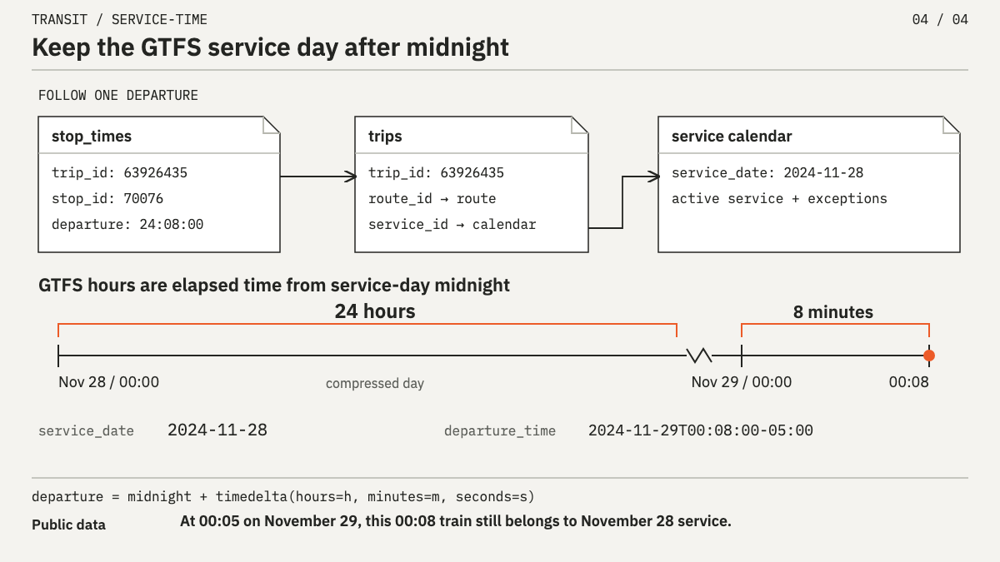
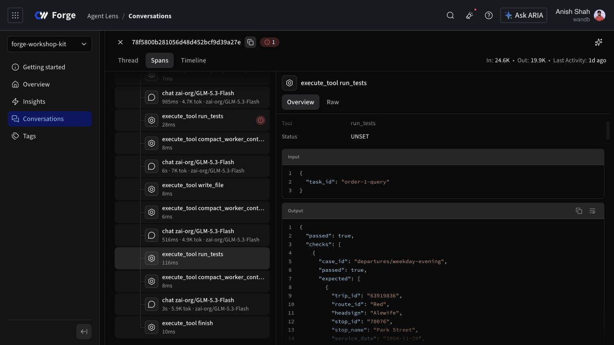
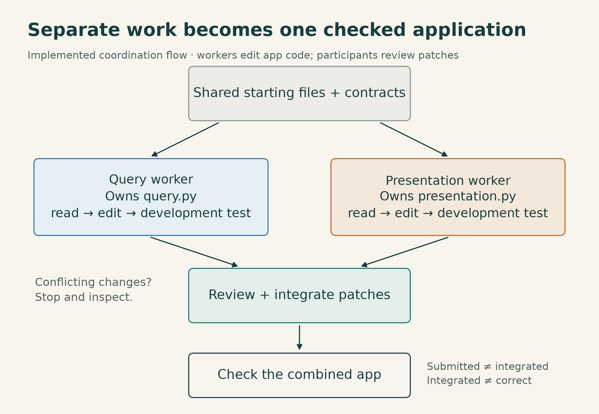
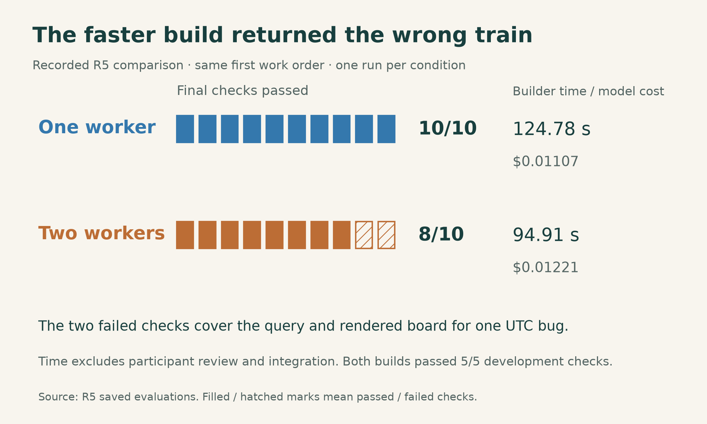
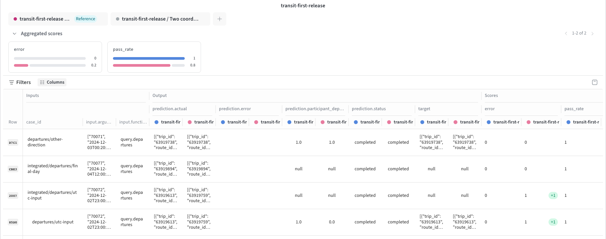
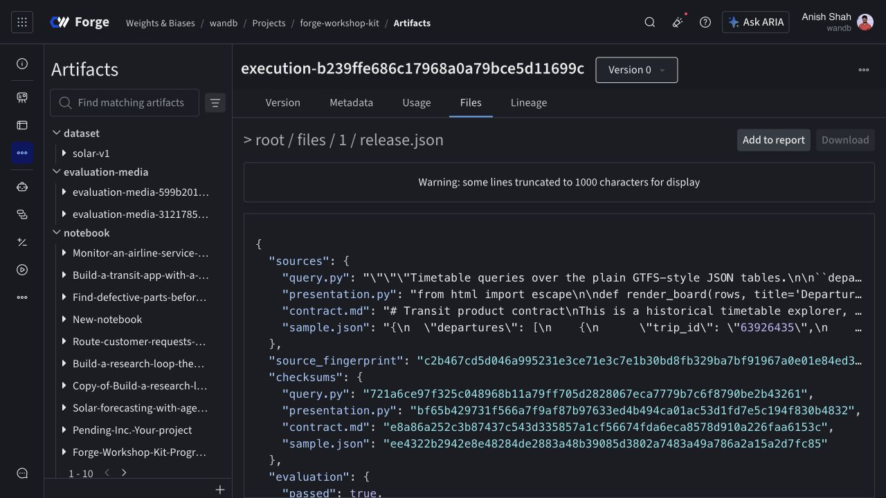
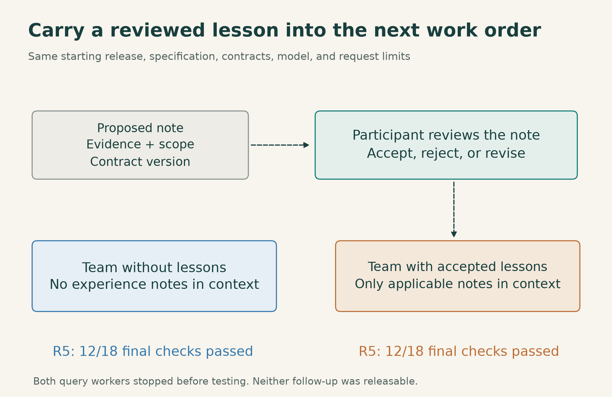

# Coordinate coding agents, then test the app they built

We wanted a small app that people leaving an evening event could use to find their next train. A schedule query and a departure board seemed like reasonable jobs for two coding agents. Give each worker a file, agree on the interface, and combine their patches.

The catch was in the timetable. A train listed at `24:08:00` belongs to the previous service day, even though the passenger's clock says it's tomorrow. A second worker can help build the screen. It doesn't remove the need for both workers to mean the same thing by “tonight.”

This workshop makes the coordination code part of the lesson. We build a worker's read–edit–test cycle, divide the work, check the combined app, and carry reviewed lessons into a later feature. The recorded team completed its build phase faster than one worker, but its app failed a timezone case. That gives us something concrete to investigate beyond whether the agents stayed busy.

This is a small software-factory exercise: agents produce patches from a work order, while participants define interfaces, review the changes, run acceptance checks, and decide what can ship. Forge keeps the assignments and tool calls visible in Agent Lens, the build measurements in runs, the source in Artifacts, and matching scenarios in EvalTables. We can test coordination and shared lessons against the application they produce.

You can read the examples here without an account. The [six-hour editable notebook](https://ash0ts.github.io/forge-workshop-kit/packet/start/transit.html) and [visual deck](https://ash0ts.github.io/forge-workshop-kit/transit/) contain the exercises. They're a technical preview; fresh-account access and a participant rehearsal remain outstanding.

## Start with a departure someone should be able to catch

The evening-event setting is fictional. The records come from the MBTA's public schedule archive for November 28 through December 4, 2024. We retain ten Red Line platforms across five stations, including their trips, stop times, and service calendars. Every build receives the same historical feed. The app does not show live arrivals.

One retained trip, `63926435`, leaves Park Street toward Alewife at `24:08:00` under the November 28 service calendar. GTFS allows hours above 23 because a service day can continue after midnight. This departure occurs at 00:08 Eastern on November 29. A passenger checking at 00:05 should see it.



*The conversion keeps the service date and the passenger's clock date separate. Rejecting an hour above 23, or checking only the new day's service, can drop this train. [Inspect the retained records](https://github.com/ash0ts/forge-workshop-kit/tree/main/examples/transit).*

We provide a reference app so you can see the expected output before asking a model to write anything. Change the stop or time and read the resulting row. Then write an acceptance check for the train, its departure time, and its service date.


*Find the `00:08` departure and its service date. This is the reference implementation, not an agent-generated result. You can [download and run it locally](https://ash0ts.github.io/forge-workshop-kit/transit/walkthrough/transit-reference-app.zip) without inference access.*

That small check gives the agent a requirement we can inspect. “Build a nice departures page” would leave much more of the behavior to its interpretation.

## Let one worker build the first version

We start with one builder. It receives the work order, the component interfaces, the starting files, and the tools it may call. Its tools read files, write changes, and run the supplied development tests. The model's next request includes the tool observation, so a failed test can affect its next edit.

You complete `build_worker_request()` and `dispatch_action()`. Those functions control what the worker sees and which proposed action executes. The worker writes the app code; you write the mechanism around it and review the patch before integration.

A trace should make that distinction visible. An assignment, a file read, a patch, and a test are separate events with worker and task identities. In Agent Lens, choose a test call, read its output, and follow the next model request. Did the worker receive the error? Did it change the relevant code, or merely announce that it was finished?



*This is the R5 team's query worker. Follow the earlier failed test, the `write_file` edit, and the selected later `run_tests` result for `order-1-query`. The visible weekday-evening development check passes. The reserved UTC case, examined below, still fails. [Open this exact test span](https://forge.coreweave.com/agent-lens/wandb/forge-workshop-kit/conversations/78f5800b281056d48d452bcf9d39a27e/spans/turns/fe62dc13f2c0ff75e6ae55712b8813de/spans/9b4bfb6dc13fc10b).*

A component test tells us about that component's checked behavior. We still need to integrate the patch and try the application, where the query's output becomes the display's input.

## Split the work without splitting the contract

For the team build, the query worker owns `query.py`, and the presentation worker owns `presentation.py`. Both receive the shared interfaces. Separate working copies let them edit concurrently; file ownership prevents one worker from silently rewriting the other's component.



*Solid arrows follow code from the starting copy through each patch into the integrated app. A conflict stops integration for inspection. Submitted, integrated, and independently checked are different states.*

The [patch-integration guide](https://ash0ts.github.io/forge-workshop-kit/guides/transit/integration/index.html) follows each owned file from its working copy into the combined app. Step backward when a failure appears to find which patch supplied the relevant code.

We also need to decide when work is ready. The kit's selection rule is deliberately small:

```python
def ready_tasks(tasks):
    # Unblock a task only after every required patch is integrated.
    return [key for key, row in tasks.items()
            if row['status'] == 'pending'
            and all(tasks[dep]['status'] == 'integrated'
                    for dep in row['depends_on'])]
```

Each row names its dependencies. A dependent task can start only after those dependencies have been integrated, rather than when a worker says it has finished.

That rule alone does not prevent a race. If two workers both read “pending” before either writes an owner, both can take the same task. `board.claim(task_id, worker_id)` checks readiness and saves the owner while holding the task-store lock. It releases the lock before the model runs, so independent work can still proceed concurrently.

The free exercise reproduces the race with two threads, then checks your atomic claim implementation. The repair changes duplicate ownership into one successful claim. We can establish that improvement directly, without hoping a model happens to mishandle coordination during the workshop.

## Check what the quicker build delivered

We compared one builder with two coordinated builders on the same first work order, starting source, model, development checks, and aggregate request allowance. Both builds passed all five public development checks. We then froze their source and ran reserved scenarios.



*These are the recorded R5 results, one build per condition. Builder time excludes human review and integration. The two-worker build saved time during that interval and failed two checks for the same underlying defect.*

The failed request arrived at 23:00 UTC, which is 18:00 Eastern. It should return trip `63919613` at 18:03 Eastern. The team query anchored the service day to the caller's timezone and returned later trip `63919759`. This changed which train the passenger saw; it wasn't just a formatting difference.

Native EvalTables aligns the same scenario across the two builds. Read the actual trip IDs in the query row, then inspect the rendered-board row. Those are two views of one bug.



*Find `departures/utc-input` and `integrated/departures/utc-input`. The reference returns `63919613`; the team returns `63919759`. [Open the recorded comparison](https://forge.coreweave.com/wandb/wandb/forge-workshop-kit?nw=dg2ogm6wp3z).*

The notebook connects each row to the integrated source, worker patches, and trace. W&B runs preserve settings and measured cost. Artifacts preserve the source, contracts, data reference, and release decision. We retained the single-worker departures board from this rehearsal. The additional worker had not earned a release merely by returning sooner.



*Open the **Files** tab, then `release.json`: `query.py`, `presentation.py`, the contract, and the sample travel together with the evaluated source identity. The UI truncates long lines, so download the artifact to inspect or reproduce the complete code. [Open this exact release version](https://forge.coreweave.com/wandb/wandb/forge-workshop-kit/artifacts/workshop-execution/execution-b239ffe686c17968a0a79bce5d11699c/v0/files/files/1/release.json).*

## Decide what the next workers should remember

The second work order asks fresh workers to find the last direct train and produce a downloadable itinerary. They need the current component contracts. They may also benefit from a checked lesson about an earlier problem.

The notebook prepares these lessons from development work before running the reserved checks described above. The later UTC failure can motivate a future experiment; it cannot become a lesson supplied to this already-frozen comparison.

We keep those records separate. The task board says who owns unfinished work. Project contracts define interfaces and units. A lesson contains an observation, supporting evidence, a scope, a contract version, and a review status. An unreviewed guess should not acquire authority just because it survived in a file.

You implement `select_memories()` to exclude proposed, unrelated, or stale notes. After a worker retrieves a lesson, inspect its next request to verify that the lesson text arrived. A memory-read event proves retrieval; the resulting code and tests tell us whether it helped.



*Dashed arrows carry reviewed evidence into a later request. Both teams receive the same starting release, requirements, contracts, model, and limits. Only accepted experience notes differ. [Open the follow-up comparison](https://forge.coreweave.com/wandb/wandb/forge-workshop-kit?nw=f9jpm0yjsxy).*

In R5, both follow-ups passed 12 of 18 final checks. Their query workers stopped at input or output limits before completing tests; the presentation work remained saved. Neither follow-up was releasable, and this pair establishes no memory benefit. The [qualification record](https://github.com/ash0ts/forge-workshop-kit/blob/main/docs/transit-workshop.md#what-the-final-engineering-rehearsal-showed) preserves these results alongside earlier attempts.

A next experiment could change the task breakdown or allowed context, but it would need a new comparison. Increasing the limit only for the build we prefer would answer a different question.

## Run the workshop in your project

The start page offers notebook copy, import, and laptop setup. You can also open the [Forge template directly](https://forge.coreweave.com/notebooks/Tm90ZWJvb2s6MTU5MzI=/view). If the hosted link sends you back to Home, use the import or local option on that page; your saved work does not need to be rerun.

[Open the Transit notebook and choose **Copy to project**](https://ash0ts.github.io/forge-workshop-kit/packet/start/transit.html). Confirm your own writable project, then try the timetable example and its free check. The [setup guide](https://github.com/ash0ts/forge-workshop-kit/blob/main/docs/setup.md) covers the hosted and laptop paths; the [deck](https://ash0ts.github.io/forge-workshop-kit/transit/) walks through the code and intermediate states.

The notebook uses your credentials and an adjustable $8 inference allowance. Compute and optional ARIA use are separate. Explicit run controls start builders. Saved responses and patches survive restart; retrying publication does not repeat a completed build.

Two ARIA activities examine development failures and the frozen comparison. At the stop, click **Start ARIA investigation** to send your explanation and the selected records. **Open ARIA conversation** takes you to that same conversation in Forge; **Check ARIA response** brings its answer back into the notebook. Verify its explanation against the worker event, integrated source, and application check. It does not accept a shared lesson or approve a release for you; recorded investigations are available without live ARIA access.

Use the [Transit packet](https://utm.io/uuIaa) for this Report, the deck, notebook, visual guides, and running instructions. A short demonstration can follow one departure through the reference app and the recorded timezone failure. In the full session, finish by reproducing a released version or explaining why a build remains blocked, with the actual scenario and patch responsible.
