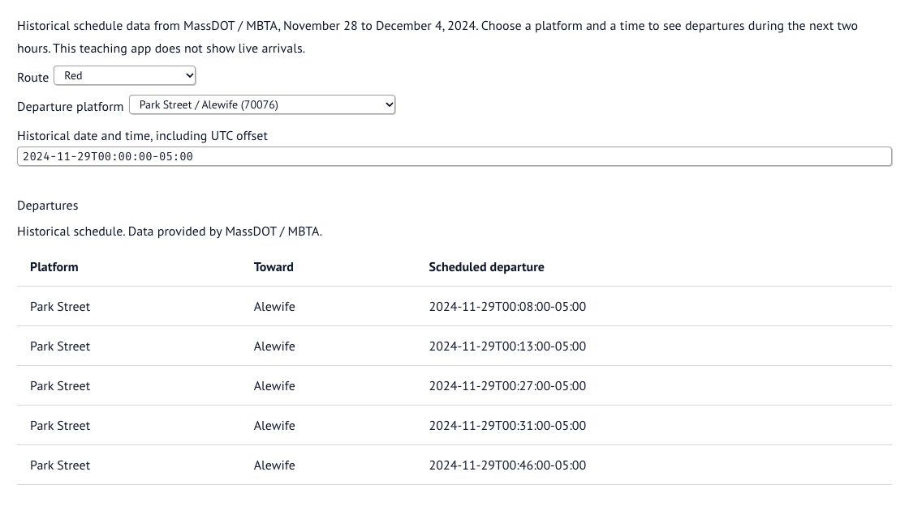

# Coordinate coding agents, then test the app they built

We built this workshop around a departure board for people leaving an evening event. It sounds like a small enough product to hand to two coding agents: one writes the schedule query, the other builds the display. They still have to agree about which day a train belongs to.

That detail became a useful way to teach agent coordination. Participants write the Python that assigns work, passes observations back to workers, reviews patches, and retrieves lessons for a later feature. They then check the resulting application. Our recorded two-worker build finished faster than the single-worker build, but returned the wrong train on a reserved scenario. We kept that result.

You can follow the example below without an account. The [six-hour notebook](https://forge.coreweave.com/notebooks/Tm90ZWJvb2s6MTU5MzI=/view) contains the implementation exercises, and the [companion deck](https://ash0ts.github.io/forge-workshop-kit/transit/) explains each step. This is a technical preview; fresh-account access and a participant rehearsal remain outstanding.

## Start with the train someone needs to catch

The product setting is fictional. Its data comes from the real MBTA schedule archive for November 28 through December 4, 2024. We freeze the feed so every build receives the same records. The subset retains Red Line platforms at five stations, along with their trips, stop times, and service calendars. It describes historical scheduled service, not live arrivals or current travel advice.

GTFS, the schedule format, separates a **service date** from the date on the passenger's clock. The retained trip `63926435` has a departure time of `24:08:00` at Park Street under the November 28 service calendar. That means 00:08 on November 29. At 00:05, the board should still include that train.



*The instructor-authored reference app makes the expected behavior visible before any agent runs. The first displayed departure belongs to the previous service day. This screen is not an agent result. [Inspect the data and reference implementation](https://github.com/ash0ts/forge-workshop-kit/tree/main/examples/transit).*

The notebook starts with this local query and an acceptance check. Participants change the input time, predict whether the train should appear, and implement a condition that catches a missing departure or an incorrect service date. That gives them a concrete requirement before they ask an agent to write code.

## Give a worker a bounded job

The first builder receives the feature request, shared interfaces, starting files, and allowed tools. Its repeated work is straightforward: read a file, propose an edit, run a development test, then inspect the returned observation. Participants complete `build_worker_request()` and `dispatch_action()` so the code they write determines what reaches the model and which action executes.

The model writes the app's query and presentation code. Participants inspect the diffs and integrate the patches before trying the board. A passing component test does not establish that the combined application returns the right departures.

We trace the assignment, file reads, edits, and tests with worker and task identities. In Agent Lens, select a test call and find the exact file version it tested. Then open the worker's next model request: did the failure reach the model, and did the next patch address it? That is a more specific investigation than reading the worker's final claim that it finished.

## Two workers need an ownership rule

Once one builder has produced an inspectable result, we split query and presentation work between two workers. Each gets a separate working copy and a file ownership contract. The task board distinguishes pending work, running work, submitted patches, and integrated changes.

The dependency rule in the kit is small enough to read:

```python
def ready_tasks(tasks):
    return [key for key, row in tasks.items()
            if row['status'] == 'pending'
            and all(tasks[dep]['status'] == 'integrated'
                    for dep in row['depends_on'])]
```

This is the implemented selection rule. A dependent task waits for integrated code, rather than a worker's completion message. The separate `board.claim(task_id, worker_id)` call checks readiness and saves one owner while holding the task-store lock. The model runs after that lock is released.

The free exercise deliberately lets two threads attempt the same task. A separate check followed by an unlocked write allows both claims; the atomic operation permits one. This demonstrates a coordination repair without arranging an agent failure. We still have to measure whether the resulting team builds a better product.

## Inspect the completed product before calling it faster

We compared one builder and two coordinated builders on the same first work order, starting source, model, development checks, and aggregate request allowance. After reviewing the builds, we froze them and ran reserved scenarios. Here is the recorded R5 engineering rehearsal:

| Build | Final checks passed | Builder elapsed time | Recorded model cost |
| --- | ---: | ---: | ---: |
| One worker | 10/10 | 124.78 s | $0.01107 |
| Two workers | 8/10 | 94.91 s | $0.01221 |

Elapsed time excludes human review and integration. Both builds had passed all five public development checks. The team was quicker within that measured interval, but its product failed the query and rendered-board checks for one underlying timezone defect.

A request at 23:00 UTC means 18:00 Eastern. The correct next trip was `63919613` at 18:03 Eastern. The team anchored the service day to the request's timezone and selected the later trip `63919759`. We were checking the chosen train, not just its display format.


*The two UTC-input rows check the query and its rendered output. They expose the same defect, so they should not become a story about two independent bugs. [Open this recorded comparison](https://forge.coreweave.com/wandb/wandb/forge-workshop-kit?nw=dg2ogm6wp3z).*

In the notebook, participants follow a comparison row back to the integrated source, worker patch, and trace. W&B runs preserve the build settings and costs; Artifacts preserve the code, contracts, data reference, tests, and release decision. The single-worker board is the supported release from this rehearsal.

## Give the next team a checked lesson

The follow-up asks fresh workers to find the last direct train and produce a downloadable itinerary. We separate three kinds of information: tasks say who owns unfinished work; contracts define interfaces and units; lessons record a reviewed observation, its evidence, and where it applies.

Participants implement `select_memories()`. A proposed note, an unrelated note, or a lesson for a superseded contract should stay out of the worker's request. After retrieval, they inspect the actual request to confirm what was supplied. A memory-read event proves consultation; it does not prove that the lesson helped.

Both follow-up teams receive the same starting release and requirements. Only access to accepted lessons differs. In R5, both builds passed 12 of 18 final checks. Their query workers stopped at input or output limits before completing tests. Neither follow-up was releasable, and this pair establishes no memory benefit. The [qualification record](https://github.com/ash0ts/forge-workshop-kit/blob/main/docs/transit-workshop.md#what-the-final-engineering-rehearsal-showed) preserves these outcomes and the earlier rehearsals.

## Run the workshop in your project

[Open the Transit notebook and choose **Copy to project**](https://forge.coreweave.com/notebooks/Tm90ZWJvb2s6MTU5MzI=/view). Confirm that the displayed destination is your own writable Forge project, then follow the opening timetable exercise and access check. [The setup guide](https://github.com/ash0ts/forge-workshop-kit/blob/main/docs/setup.md) also covers running the same notebook locally.

The notebook uses your credentials and an adjustable $8 inference allowance. Notebook compute and optional ARIA use are separate. Local checks need no model call; explicit run controls start builders. Saved work can be resumed, and failed publication can be retried without repeating a completed build.

By the end, you'll have the coordinator you edited, an app or a documented blocked release, and records showing who changed each component and which checks it passed. Your conclusion can be that the extra worker was not worth it for this task. The comparison is there to help you make that decision.
