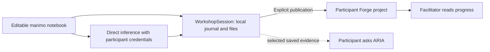
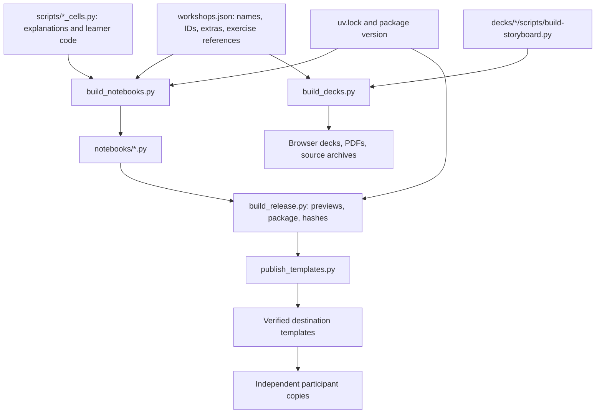
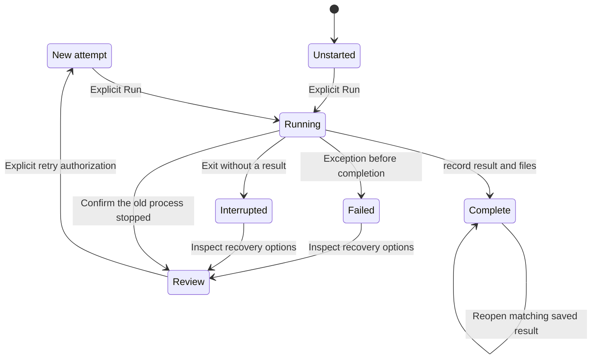
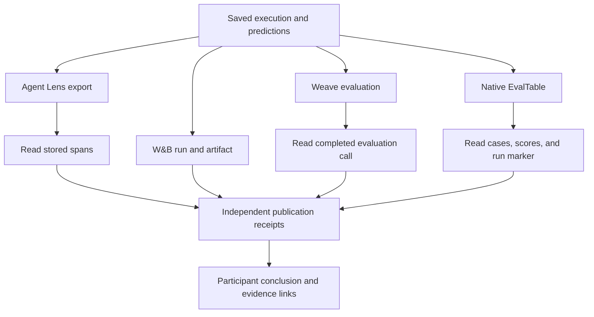

# Workshop Kit architecture

Workshop Kit runs editable teaching code in a participant's notebook and saves enough information to inspect and resume that work. The participant owns the Forge project, credentials, inference allowance, and notebook runtime. The facilitator reads published progress from projects on a roster. There is no workshop gateway or shared credential service.

This document describes the implemented contracts. Use the [README](README.md) to choose a workshop, [authoring guide](docs/authoring.md) to change a lesson, and [next steps](next-up.md) for outstanding work. Detailed dataset and experiment contracts stay with their workshop guides.

## System boundaries



Solid arrows show execution or data movement. Dashed arrows show evidence supplied for an investigation. The ARIA card assembles context locally; sending a native ARIA question remains a participant action.

Three boundaries matter when contributing:

- **Lesson code owns the experiment.** Tools, training, scoring, evidence selection, and agent controllers remain in authored cells or inspectable workshop modules. Shared helpers handle identity, saving, accounting, presentation, and publication.
- **Execution and publication have separate records.** A completed experiment can have an unavailable trace or comparison. Repairing an export must not repeat the experiment.
- **Teaching controls are not security isolation.** Local files and graders are inspectable. Reviewed subprocess execution removes inherited credentials and limits runtime, but it is not an adversarial sandbox.

## Authoring and generated materials

The same authored cells generate the hosted and laptop notebooks. Contributors change the authored source, then regenerate the notebook. A participant can edit their copied notebook without changing the template.



[`workshops.json`](src/forge_workshop_kit/workshops.json) owns workshop IDs, workflow compatibility versions, titles, step labels, dependency extras, comparison metrics, exercise references, and ARIA stop definitions. [`manifest.py`](src/forge_workshop_kit/manifest.py) reads that metadata without importing a lesson's ML stack. The manifest does not schedule work.

[`authoring.py`](src/forge_workshop_kit/authoring.py) binds stable cell IDs and checks exercise references. Those records connect a notebook step to its editable function, free check, control, prerequisite, output, and Forge investigation. Explanations and learner functions remain authored Python, not generated from metadata.

[`build_notebooks.py`](scripts/build_notebooks.py) and [`notebook_builder.py`](scripts/notebook_builder.py) generate marimo source. [`release_support.py`](scripts/release_support.py) derives hosted dependency pins from the same lockfile used locally. [`pyproject.toml`](pyproject.toml) is the package-version source; the manifest's workflow versions are separate. A copy edit or release-number change must not invalidate completed experiments.

The decks share [`decks/package.json`](decks/package.json), styles, and the visual definitions in [`assets/visuals.json`](src/forge_workshop_kit/assets/visuals.json). Storyboards generate slides and notes. The build exports browser copies, PDFs, and editable archives; validation inspects reveals, links, images, and rendered text. Build and publication commands are documented in [maintenance](docs/maintenance.md).

## Project and workspace identity

[`setup.py`](src/forge_workshop_kit/setup.py) detects the copied notebook's project from `WANDB_ENTITY` and `WANDB_PROJECT`. In a hosted notebook, those values take precedence over a local `WORKSHOP_PROJECT` default. Local users can supply their project explicitly.

[`WorkshopSession`](src/forge_workshop_kit/session.py) binds four values:

| Value | Meaning |
| --- | --- |
| `project` | The `entity/project` used for inference attribution and publication |
| `workshop` | The workflow ID from the manifest |
| `version` | The workflow compatibility version, not the package version |
| `workspace_id` | One participant notebook copy or local state directory |

Hosted identity uses `WANDB_NOTEBOOK_ANCHOR_RUN`, which survives renaming and runtime replacement. `WANDB_NOTEBOOK_COLLECTION` remains a fallback for older hosts. The workspace ID is derived from project, workshop, workflow version, and notebook identity. A new copy receives a different identity. A local workspace creates a UUID once and stores it in `identity.json`.

The default state directory is below `.workshop/<workshop>/`. `WORKSHOP_STATE_DIR` or an explicit `state_dir` can select another directory. Opening an existing directory checks its project, workflow, version, and notebook identity before using it. A directory belonging to another copy is rejected rather than silently adopted.

Constructing a session writes local identity and journal files. It does not authenticate, train, or call a model. The explicit access check reads the project and writes a small access run. It establishes project write access only. Trace readback, inference access, Weave, EvalTables, and ARIA remain separate capabilities.

## Explicit execution and recovery

A stage represents one execution specification:

```text
stage ID = hash(workspace ID, name, config, sources, inputs, attempt)
source fingerprint = hash(sources)
```

The caller must include every result-changing dependency in `config`, `sources`, or `inputs`. A stage name alone does not describe the experiment. Dataset references, code, selected versions, and settings must agree before two controls can reuse a result.

The context manager records state but cannot skip Python statements inside its body. Authored action cells use this pattern:

```python
with session.stage(
    "baseline",
    config=config,
    sources={"model.py": source},
    inputs={"dataset": dataset_ref, "split": "validation"},
) as stage:
    if stage.needs_run:
        result, files = run_experiment(source, config, dataset_ref)
        stage.record(result, files=files)

result = stage.result  # New result or the matching saved result.
```

This is a structural example; each notebook supplies its actual experiment function. It belongs behind an explicit run control, never in a render or navigation callback.



Successful matching attempts take precedence over failed siblings. A completed result is returned from storage. `retry_stage()` authorizes a new attempt but does not start it. Running or uncertain work requires confirmation that the prior process stopped. An exception after `stage.record()` is recorded as a post-execution error; it does not erase completion.

Tool errors can otherwise disappear before a result exists. [`traces.event()`](src/forge_workshop_kit/traces.py) records actual arguments, start/end times, return value or exception, and an event ID. Passing `stage.record_event` as its error callback preserves that evidence before the original exception propagates.

Multi-result exercises retain a stage per model or case. A checkpoint is complete only when the required matching results exist. Solar also tracks native Sweep assignments separately: a cached training result is not proof that the Sweep assigned that configuration. Transit can preview a solo integration early without selecting the starting release for the later memory comparison.

### Drafts and display state

`save_draft()`, `get_draft()`, `set_view()`, and `get_view()` operate on the local journal. Saving code does not mean that code ran. The notebook compares the draft with the source recorded for the executed stage and runs local checks against the current draft.

[`ui.py`](src/forge_workshop_kit/ui.py) renders navigation, results, branch views, prerequisites, and evidence links. It does not execute experiments. Bind returned marimo controls to notebook globals so their callbacks remain registered. Results must be reconstructed from saved stages, not only from a temporary output dictionary.

## Inference accounting

[`provider.py`](src/forge_workshop_kit/provider.py) calls W&B Inference directly with the participant's credentials and selected project. It keeps the fixed model and request settings in one module. The default session allowance is $8 and can be changed by the participant. It does not cover notebook compute, native tag judging, or ARIA usage, and it is not a provider billing cap.

Before each transport attempt, the client records the complete request and a conservative reservation based on an input-size bound and the requested output limit. In a connected hosted session it also publishes the small request ledger before sending; an unsuccessful ledger upload stops the send. This avoids uploading all previous model outputs before every request.

Request reuse checks the entire saved envelope, including messages and settings. A matching completed response is reused even if an earlier attempt failed. Reusing an ID with different contents is rejected.

| Outcome | Saved behavior |
| --- | --- |
| Response with measured usage | Save response, usage, timestamps, model identity, and calculated cost |
| Response without valid usage | Keep cost unknown and retain the reservation |
| Retryable provider error | Permit bounded transport retries within the allowance |
| Lost or ambiguous response | Stop; do not automatically resend; retain the full reservation |
| Access denial | Explain the credential or inference-access failure |
| Unexpected model or usage above the reservation | Stop further inference for accounting review |

The client permits at most three transport attempts and enters a cooldown after repeated explicit failures. `validated_json()` can make one additional schema-repair request under its own saved request identity; it is also charged and retained. Account reconciliation must preserve uncertainty rather than turning missing usage into zero.

## Local saving and artifact restore

The workspace is a small file store guarded by a file lock. JSON writes use a temporary file followed by atomic replacement. State is split by purpose:

| Record | What it contains |
| --- | --- |
| `identity.json` | Project, workflow, version, notebook identity, workspace ID |
| `journal.json` | Stages, provider receipts, drafts, progress, publication receipts, and review notes |
| `outputs/<stage-id>/` | Explicitly registered source, model, prediction, state, and diagnostic files |

`Stage.record()` copies registered files into the stage output directory and serializes the result before marking it complete. It rejects missing files, conflicting filenames, and non-JSON values such as NaN. Missing scores remain `None`.

[`publication.py`](src/forge_workshop_kit/publication.py) uses three different saving paths:

1. **Progress and help** update a normal `workshop-progress` run. A separate lock keeps these updates from waiting behind artifact uploads.
2. **Stage publication** writes an execution run and a checksummed `workshop-execution` artifact. Later checkpoints reference its exact immutable output entries.
3. **Checkpoint publication** saves the current journal, drafts, identity, and output references. The request ledger is a smaller artifact with only recovery and accounting state.

Artifacts are assembled from explicit registered files. The publisher does not recursively upload a runtime home directory or environment files.

Restore downloads into a temporary directory, verifies identity and checksums, resolves immutable output references in the same project, and checks for local conflicts. It installs output files before replacing the journal. A partial download cannot install a journal that claims missing outputs are complete. Newer local work and conservative accounting are merged rather than overwritten by an older checkpoint.

The normal `session.restore()` path leaves an already populated local execution journal in use. Restoring, reopening, or selecting a view never retries an execution.

## Traces, comparisons, and Reports



Publication functions read saved work. They do not call the forecasting model, agent, scorer judge, or training loop again. Weave evaluation publication invokes small saved-prediction and saved-score functions to represent the existing rows as native evaluation records.

### Agent Lens

[`traces.py`](src/forge_workshop_kit/traces.py) creates Forge SDK conversation, turn, model, and tool scopes from independent receipts. Actual operation timestamps, request model, returned usage, arguments, results, and errors are retained. Worker, task, dispatch, parent-conversation, and explicit turn identities support Transit and Airline without changing existing callers.

The exporter saves its trace identity before flushing. A retry first checks the previously exported trace. Readback verifies span counts, tool identities and values, model identity, and available usage. Only a verified receipt is treated as a usable participant trace link. Export failures can leave traces incomplete; they do not invalidate saved execution results.

### Aligned evaluations

`publish_comparison()` maintains separate W&B, Weave, and native EvalTable receipts for each exact version's rows. Adding another version does not republish successful earlier versions. Each version has one row per `case_id`; matching cases must have identical inputs. Version names and trace links belong in outputs or evidence, not in the inputs used for alignment.

The manifest declares metric names, units, direction, and aggregation. Mean row metrics can be aggregated during publication. Macro-F1 and average precision must come from the scorer's aggregate over frozen predictions; averaging per-row values would change their meaning.

[`media.py`](src/forge_workshop_kit/media.py) validates image descriptors and keeps structured values and images typed during publication. [`eval_tables.py`](src/forge_workshop_kit/eval_tables.py) uses the pinned SDK's `wandb.EvalTable(..., backend="weave")`. It saves the SDK evaluation marker and reads back case identities, non-image inputs and outputs, scores, and the logged run marker. Image readback verifies the media envelope and file references, not every pixel. [`eval_workspace.py`](src/forge_workshop_kit/eval_workspace.py) creates a named comparison view without replacing the project's default workspace.

If export is interrupted after the evaluation marker is saved, retry resumes readback. If the write may have succeeded but no marker was saved, the publisher requires investigation instead of automatically creating another evaluation. See [evaluation recovery](docs/evaluations.md) for the native UI and recovery steps.

### Reports

`publish_report()` requires a participant-written conclusion, uses the current workspace's runs and metric definitions, and links the evidence supplied by the notebook. A saved receipt allows repeated publication of the same content to reuse the Report. Task-and-version labels keep image and measurement results distinct. A checked ARIA note can appear as the participant's assessment, with an optional conversation link.

## Measured agents and ARIA investigations

The notebook's measured agents propose edits, route requests, operate tools, or build code according to the workshop. Their requests, code, results, and cost enter the experiment. ARIA has a separate teaching role: discuss already saved evidence and challenge the participant's interpretation.

[`aria.py`](src/forge_workshop_kit/aria.py) resolves explicit saved stage IDs from the current workspace. Early stops use manifest allowlists for development or validation stages and reject nested reserved-result declarations. The context includes source and evidence fingerprints, bounded saved observations, file names, and available native links. It does not read an entire journal into a prompt or manufacture an attachment from a filename.

Opening the card, selecting evidence, copying a prompt, reading a recording, and saving a citation note are local actions. Participants open Forge and send the question themselves. Native attachments are UI actions, not an effect of pasting `@run-name` text.

Saved notes include the stop, live or recorded mode, selected evidence identity, interpretation, checked claim, citation, and supported/disputed/unresolved assessment. A note stays bound to its original evidence when the selected case changes. It is not a score, training label, release approval, experiment prerequisite, or automatic input to the editor. Missing notes remain compatible with old journals.

Evidence selection does not restrict ARIA's project permissions. An answer that uses reserved results must be excluded from development decisions. Recorded packs under [`assets/aria/`](src/forge_workshop_kit/assets/aria/) preserve actual instructor responses, source excerpts, captures, and limitations for participants without live access. The [ARIA guide](docs/aria-investigations.md) owns access and activity instructions.

## Domain code and experiment boundaries

The common package supplies records and publication. Workshop modules define the actual work and constraints:

| Workshop | Authored cells | Runtime and fixed comparison rules |
| --- | --- | --- |
| Pending | [`pending_cells.py`](scripts/pending_cells.py) | [`pending/`](src/forge_workshop_kit/pending/): simulated office tools, local MCP, harness execution, learner checks, and independent state scoring |
| Solar | [`solar_cells.py`](scripts/solar_cells.py) | [`solar.py`](src/forge_workshop_kit/solar.py), [`training.py`](src/forge_workshop_kit/training.py), [`research.py`](src/forge_workshop_kit/research.py): partitions, scoring, training subprocess, proposals, tested composition, and freeze validation |
| Routing | [`routing_cells.py`](scripts/routing_cells.py) | [`routing.py`](src/forge_workshop_kit/routing.py), [`review.py`](src/forge_workshop_kit/review.py), [`routing_release.py`](src/forge_workshop_kit/routing_release.py): classifiers, reviewed labels, release bundle, controlled mapping defect, and rollback |
| Inspection | [`inspection_cells.py`](scripts/inspection_cells.py) | [`inspection.py`](src/forge_workshop_kit/inspection.py), [`inspection_teaching.py`](src/forge_workshop_kit/inspection_teaching.py): representations, review budgets, thresholds, and frozen detector comparisons |
| Transit | [`transit_cells.py`](scripts/transit_cells.py) | [`factory.py`](src/forge_workshop_kit/factory.py), [`transit.py`](src/forge_workshop_kit/transit.py), [`transit_workshop.py`](src/forge_workshop_kit/transit_workshop.py): atomic claims, isolated copies, patch integration, scoped lessons, acceptance scenarios, and app export |
| Airline | [`airline_monitoring_cells.py`](scripts/airline_monitoring_cells.py) | [`airline.py`](src/forge_workshop_kit/airline.py), [`agent_lens.py`](src/forge_workshop_kit/agent_lens.py), [`airline_regression.py`](src/forge_workshop_kit/airline_regression.py): booking state, confirmations, native tag records, review curation, and matched monitoring/evaluation batches |

Keep reserved evaluation evidence out of proposal, repair, rubric-tuning, and early investigation contexts. Preserve the actual frozen inputs and source in the stage identity. A `KEEP` decision must retain the source; a composition that changes source must be executed before it can count as a tested selection.

Solar candidate training and Transit application checks use bounded subprocesses with explicit environments. Pending's onboarding tools use local MCP. These mechanisms make execution inspectable and limit accidental credential inheritance; isolated directories and import checks are not a security sandbox. Remote Sandboxes, SFT, Registry, and managed jobs are optional extensions described under [advanced modules](docs/advanced/README.md), with their own access and cost requirements.

## Facilitator monitoring

[`monitoring.py`](src/forge_workshop_kit/monitoring.py) reads `workshop-progress` runs through the W&B API. The facilitator keeps a local roster of project links, workspace or notebook-copy filters, and optional last-update bounds. Reads across projects are bounded and concurrent. Monitoring does not import lesson runtimes, execute participant code, change participant settings, or rank model scores.

The view distinguishes an absent update (`unknown`) from a failed read (`unavailable`) and an explicitly failed execution. It shows the saved step, completed checkpoints, help request, last published update, and evidence links. ARIA summaries contain activity mode and citation-check status, not private conversation contents. Missing or delayed progress cannot block participant work.

## Build, publication, and validation boundaries

[`cli.py`](src/forge_workshop_kit/cli.py) wraps existing source-checkout tools. It scaffolds lessons, opens notebooks, runs free checks, checks setup, builds artifacts, starts explicit rehearsals, and publishes selected templates. Installing only the participant wheel does not install the authoring tree or storyboards.

[`publish_templates.py`](scripts/publish_templates.py) verifies the built release and uploaded wheel, scopes receipts by destination project, checks each notebook's project before updating it, and reads back source and preview hashes. An interrupted creation without a saved notebook ID requires reconciliation rather than creating another notebook. Existing attendee copies are independent and remain unchanged.

[`rehearsal.py`](src/forge_workshop_kit/rehearsal.py) provides two paths. Replay reads an existing journal without creating a session, executing code, or publishing. The interactive live adapter executes current authored action cells using their stable IDs, inputs, and review gates. It does not choose a candidate or approve a release on the participant's behalf.

Validation distinguishes free checks, domain execution, authored-cell execution, browser interactions, external-account access, and human rehearsal. Passing one does not establish the others. Tests for the shared contracts include [`test_session.py`](tests/test_session.py), [`test_copy_recovery.py`](tests/test_copy_recovery.py), [`test_provider.py`](tests/test_provider.py), [`test_publication.py`](tests/test_publication.py), [`test_traces.py`](tests/test_traces.py), [`test_eval_tables.py`](tests/test_eval_tables.py), and [`test_aria.py`](tests/test_aria.py).

## Current limits

The current workshops are technical previews. [Release checks](docs/release-checks.md) record the tested paths and outstanding external-account and human rehearsals. A successful maintainer upload or static notebook preview is not an attendee-access test.

Native EvalTables use the verified Weave-backed path. That does not establish recovery of the separate CES backend. Airline's recorded Alignment failures and unavailable Insights remain documented in its [qualification record](docs/airline-monitoring-qualification.md). Missing native judgments stay unavailable rather than becoming passes.

Local inference accounting cannot cap server-side tag or ARIA usage. Native access and UI capabilities can also differ by organization. These are operational limits to check during qualification, not reasons to add another central service to the participant path.
